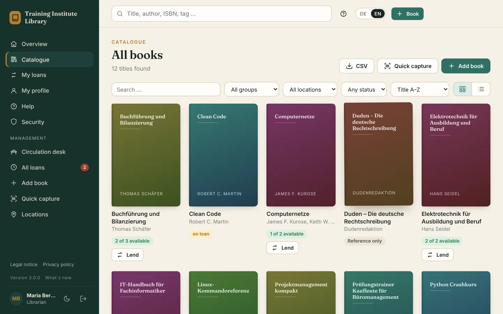
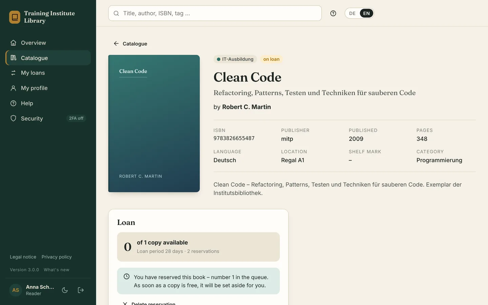
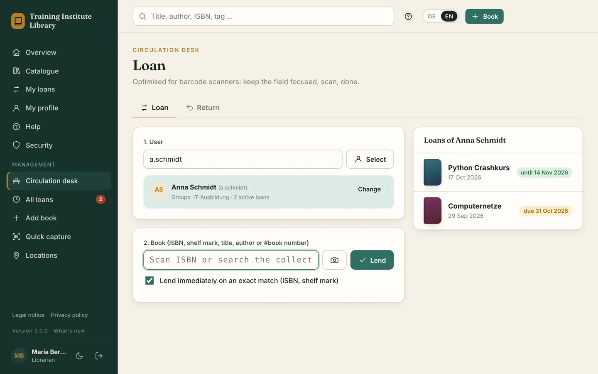

# Catalytix

**Version 3.1.3** – see [CHANGELOG.en.md](CHANGELOG.en.md) for changes ([German](CHANGELOG.md)). · [Deutsche Version](README.md) · Developed by [helfi.space](https://helfi.space)

Web-based library management with ISBN scanning, lending, groups and sign-in via Active Directory (Windows Server or Samba). Free software under the [GNU AGPL v3](#license). “Catalytix” is the project name – the interface only shows the name of your library.

> **Note:** The user interface is bilingual – German and English (switch DE/EN at the top; the language of the browser is used first). Some menu names in this document are still given in German with the English label, e.g. *Administration → Einstellungen* (Settings).

- **Catalogue** – add books by hand or by ISBN: USB/Bluetooth barcode scanner, phone/laptop camera or typing. Metadata and covers are fetched automatically from the German National Library (DNB), Open Library and Google Books.
- **Locations** – fixed list of shelves and rooms; picked from a list instead of typed when adding books.
- **Quick capture** – scan one ISBN after another; accept new titles with one click, or add a copy to an existing title. Adding an existing book again (same ISBN, same group) adds the copies to it instead of creating a second entry.
- **Search as you type** – matching books (search box at the top) and people (circulation desk) appear while typing.
- **Lending** – self-checkout, lending straight from the catalogue, a circulation desk optimised for scanners, returns, renewals, overdue tracking, loan limits, optional **reservations** of books on loan with a queue and collection period.
- **Groups** – each group has its own collection; members can only borrow books of their groups (plus "general" books). A group can be **reference only**: its books are in the catalogue but are neither lent out nor reserved.
- **Roles** – reader, librarian, administrator. The local admin account always works.
- **Self-registration** (optional, off by default) – with admin approval, e-mail verification and domain restrictions.
- **Custom branding** – logo, login background image, colours and welcome texts.
- **Two-factor authentication** with an authenticator app (TOTP) or security keys (YubiKey/FIDO2, passkeys), recovery codes and a per-role policy.
- **E-mail notifications** via SMTP – loan and return confirmations, due-date reminders, overdue notices, daily digest for librarians.
- **Active Directory / LDAP** – freely define which AD groups (or OUs) may sign in, manage or administer. AD groups can be mapped to library groups.
- **Automatic backups** – daily, the last 10 backups are kept (configurable).
- Modern, responsive design with light and dark mode. Data stored in **SQLite** (default), optionally MySQL/MariaDB or PostgreSQL.


<p align="center">
  
</p>
<p align="center">
  
  
</p>
<p align="center"><sub>Catalogue · book page with a reservation · circulation desk (demo data)</sub></p>

---

## Quick start

Catalytix is completely inside the ready-made image `ghcr.io/soleil0815/catalytix` (Intel/AMD and ARM, e.g. Synology or Raspberry Pi). The server only holds **`docker-compose.yml`, `.env` and the data folder `./data`** – no program folder, nothing to unpack or build.

### Installation

```bash
mkdir -p /opt/catalytix && cd /opt/catalytix
curl -fsSLO https://github.com/soleil0815/catalytix/releases/latest/download/docker-compose.yml
curl -fsSL  https://github.com/soleil0815/catalytix/releases/latest/download/env.example -o .env
chmod 600 .env                # may hold passwords later (e.g. DATABASE_URL)
docker compose up -d          # older installations (e.g. Synology): docker-compose up -d
```

Everything in `.env` is optional (port, time zone, database …) – without an entry the default applies. Then open `http://SERVER:9300` (e.g. `http://library.company.local:9300`). On the first visit you create the local administrator account; the page asks for the **setup code**. It is in the container log (`docker compose logs catalytix`) and can be shown any time with `docker compose exec catalytix docker-entrypoint.sh flask --app wsgi setup-code`. This way nobody who happens to reach the port can take over the setup.

At start-up the container sets the permissions of `./data` itself and then runs as user `PUID:PGID` (default `1000:1000`) – not as root. Additions (e.g. a NAS share for backups or a MariaDB) go into your own `docker-compose.override.yml`, which is never touched.

Optional, for updates by hand with an automatic way back: put `update.sh` into the same folder (`curl -fsSLO https://github.com/soleil0815/catalytix/releases/latest/download/update.sh && chmod +x update.sh`).

### Updating

**With a container manager** (Dockhand, Watchtower, Tugtainer …): let it update the container like any other. Recommendation: schedule updates **at night** (e.g. 3 am) – the library is unavailable for a moment while a new version starts.

**By hand:**

```bash
docker compose pull && docker compose up -d
```

**Or with `./update.sh`** – does the same, and in addition:
- keeps the running image as `previous`,
- waits until the new version reports healthy; **if it does not start**, it restores the backup from before the update and starts the previous version again (asks first, automatic with `-y`) – and stays on it for now, so a container manager does not install the failing version again right away,
- puts a newer `docker-compose.yml` from the image in place (the old one is kept as `docker-compose.yml.alt`) and keeps `update.sh` and `.env.example` current.

```bash
./update.sh                     # newest version (or the one fixed in .env)
./update.sh --version=3.0.0     # exactly this version – also a security update like 3.0.0-s1
./update.sh --version=latest    # follow every new version again
./update.sh -y                  # no questions (e.g. from cron)
```

Runs with `/bin/sh` (also dash/BusyBox) and on a NAS; needs Docker Compose as `docker compose` or `docker-compose` 1.27 or newer. Without a terminal (cron, `ssh` without `-t`) and without `-y` it decides nothing by itself.

**What the program does itself at every version change:** before a new version changes the database, it backs it up (backup `catalytix-…-vor-<version>.db` under *Administration → Backup*; the last three are kept independently of the daily ones). If an **older** version starts on a database a newer one has already used, it stops with a clear message (which version or which backup) instead of running into follow-up errors. With MySQL/PostgreSQL, back up yourself before updates (`mysqldump`/`pg_dump`).

If the `docker-compose.yml` on the server is too old for a new version, the log says so and administrators see a note on the overview – then run `./update.sh` once or replace the file with the one from the release.

### Fixing a version and going back

**Fixing:** set `CATALYTIX_TAG=3.0.0` in `.env` (or `./update.sh --version=3.0.0`) – it stays on this version, also with a container manager. `CATALYTIX_TAG=latest` (or no such line) follows every new version again.

**Going back:** an older version needs the database from back then. `./update.sh --version=X.Y.Z` does both: it restores the newest backup this version can read and starts it (it asks first, because everything entered since is lost). By hand:

```bash
docker compose stop catalytix
docker compose run --rm -e CATALYTIX_SKIP_DB_CHECK=1 catalytix flask --app wsgi restore-for-version 3.0.0
# set CATALYTIX_TAG=3.0.0 in .env
docker compose up -d
```

(`restore-for-version` still runs in the newer image here – it knows the command. `list-backups` shows all backups.)

### Without internet

The release contains the images as files (`catalytix-X.Y.Z-amd64.tar.gz`, `-arm64` for ARM) with `SHA256SUMS`. Copy the file, `SHA256SUMS` and `update.sh` to the server, then:

```bash
./update.sh --load catalytix-3.0.0-amd64.tar.gz     # checks the checksum, loads the image, starts it
```

Without `update.sh`: `sha256sum -c SHA256SUMS --ignore-missing`, `docker load -i catalytix-3.0.0-amd64.tar.gz`, set `CATALYTIX_TAG=3.0.0` in `.env`, `docker compose up -d`.

### Moving installations from before 3.0.0

Up to 2.20 the program files were on the server (zip package, built locally). From 3.0.0 everything is in the image. Once, in the existing program folder:

1. Take a backup: *Administration → Backup → Back up now* (the program also backs up itself at the first start of 3.0.0).
2. Switch to the image once with the **existing** script: `./update.sh --pull`. It gets 3.0.0, places the new `docker-compose.yml`, `.env.example` and the new `update.sh`, and starts it. (If your script does not know `--pull` yet – before 2.16 –, put the new `update.sh` from the release into the folder instead and run `./update.sh`; the old `docker-compose.yml` is then kept as `docker-compose.yml.alt`.)
3. Remove the old program files: `./update.sh --cleanup`. It shows the list (only known program files such as `catalytix/`, `Dockerfile`, `wsgi.py`, old zip packages, work folders of aborted updates and locally built `catalytix:X.Y.Z` images), asks, and deletes only those. **Never** touched: `data/`, backups, `.env`, `docker-compose.yml` (with `.alt`/`.override`) and anything a container mounts – not even through links.

Afterwards the folder only holds `docker-compose.yml`, `.env`, `.env.example`, `update.sh` and `data/`.

### For developers: without Docker

```bash
python3.13 -m venv .venv && . .venv/bin/activate     # Windows: py -3.13 -m venv .venv; .venv\Scripts\activate
pip install --no-deps -r requirements.txt
export CATALYTIX_DATA_DIR=/var/lib/catalytix
gunicorn -w 2 --threads 4 -b 0.0.0.0:9300 wsgi:app   # Windows: waitress-serve --listen=0.0.0.0:9300 wsgi:app
```

`python wsgi.py` is enough to try it out (`127.0.0.1:9300` only). Building the image yourself: `docker build -t catalytix-dev .`

### Pinned versions and automatic security updates

**Every build is reproducible** – all inputs are in the repository with an exact version:
- **Base image** with fixed version and digest (`ARG PYTHON_IMAGE=python:3.13.x-slim-trixie@sha256:…` in the `Dockerfile`). The name defines the **foundation**: Debian 13 "trixie", Python 3.13.
- **Debian packages:** all packages in the image, including those of the base image, are brought to a fixed state of the Debian archive (`ARG DEBIAN_SNAPSHOT=…`, via snapshot.debian.org). The exact versions are listed in the image under `/app/image-packages.txt`.
- **Python packages:** `requirements.txt` contains all packages, including indirect ones, with exact version and the SHA-256 of every file – pip installs nothing else (`--require-hashes`). `pip` itself is in `docker/pip.lock` and is removed from the image after installing.
- **Fix new versions:** `python3 tools/lock.py update` (needs Docker and internet) – always **within the foundation**: same Debian release, same Python series, every package within its major version (before 1.0: minor version; ranges in `requirements.in`). No limit for calendar versions such as the root certificates (`certifi`). New package versions are only taken once they are at least 7 days old (protection against freshly uploaded malicious releases). `python3 tools/lock.py check` verifies the locks.

**Automatically on GitHub** (details under [GitHub](#github-building-the-image-and-publishing-versions)):
- **Every Monday early – security update:** fix the newest versions within the foundation, rebuild without cache, run the tests in the finished image, scan with Trivy. Only if **everything** passes is the image published as `latest` and as **`<program version>-s<counter>`** (e.g. `3.0.0-s1`, `3.0.0-s2` – "same program, only new packages"; a new program version starts again at `s1`), with an entry in both change logs (German and English) listing the changed packages. If nothing changed, nothing happens.
- **Daily:** Trivy scans the published `latest` for vulnerabilities that became known after the release.
- **Weekly:** check how long Debian 13 and Python 3.13 still get security updates. From 12 months before: a notice on the run; from 6 months: the run turns red. Nobody raises the foundation silently – it is a deliberate change (see below).

**If a run turns red,** nothing is published, the running installation stays as it is, and GitHub sends an email. The cause is shown at the top of the run (*Actions* → open the run, annotations and summary):

| Run / message | Meaning | What to do |
|---|---|---|
| *Security update* – "lock: no release of … / no resolution … older than the cool-down" | A new or changed package (also a dependency that is new) is younger than 7 days and there is no older fitting version (otherwise the run takes the next older one automatically) | Wait – a later run takes it. For an urgent fix: *Run workflow* with `cooldown_days` = `0` |
| *Security update* – "Trivy: … blocking finding(s)" | A package has a serious vulnerability with a fix, but the fix is not in the image yet – usually because it is younger than 7 days | Wait (next Monday) or start *Actions → Security update → Run workflow* with `cooldown_days` = `0`. If that does not help, the fix is outside the foundation (e.g. only in a new major version) – raise that package deliberately |
| *Daily scan* red | A new vulnerability became known for the published image | Same: start *Security update* by hand; if it is not exploitable, add it to `.trivyignore` with a reason and an expiry date |
| "Tests failed in the new image" | A package update does not work with the program | Check the log, adapt the program or limit the package in `requirements.in`, new program version |
| "Locking failed" / "Image build failed" | Docker Hub, PyPI or snapshot.debian.org were unreachable or returned something unexpected | Usually temporary: start the run again later |
| "Unreleased build changes on main" | `main` has changes to `Dockerfile` or `requirements.in` that are not in a release yet | Publish a new program version first |
| *Foundation check* yellow/red | The Debian release or Python series gets no security updates in ≤ 12 or ≤ 6 months | Raise the foundation deliberately: switch the `Dockerfile` and `tools/lock.py` (`FOUNDATION`) to the new Debian release or Python series, `tools/lock.py update`, all tests, new program version |

**What stops Trivy:** HIGH/CRITICAL vulnerabilities with an available fix, and secrets found in the image (e.g. keys) – the latter always. Both platforms (amd64 and arm64) are scanned, and exactly the tested and scanned image is published.

**`.trivyignore`:** only checked, non-exploitable findings – each entry `ID exp:YYYY-MM-DD` (at most 6 months) with a comment line above it as the reason. After the expiry date the finding blocks again.

**Built yourself** (`docker build .` from the repository) gives the same image as on GitHub; the build needs access to Docker Hub, PyPI and snapshot.debian.org.

---

## Language and help

**German and English.** Everyone switches with **DE / EN** at the top right (also on the sign-in page). When signed in, the choice is saved in the profile – it then applies on every device and to the emails sent to that person. Without a choice, the browser language is used, otherwise the **default language** from *Settings → General* (default: German). Dates follow the language (20.10.2026 / 20 Oct 2026). Data such as book titles, group and location names stay as entered.

**Built-in help** (*Help* in the sidebar or **?** at the top right):
- Everyone sees only the topics for their role – readers 7, librarians 7 more, administrators all 25.
- The **?** jumps straight to the section for the current page (e.g. from the circulation desk to the desk help).
- The texts follow your settings: loan period, renewals, self-checkout, email reminders, registration, mandatory 2FA, AD or local account …
- A search box covers all topics; the **PDF manual** (German or English, matching the language) is linked there.

**What's new:** At the bottom of the sidebar (next to the version number) and in the user menu there is *What's new* – short, plain notes on new features, improvements and security updates, depending on the role (readers don't see admin-only topics). When an update brings something new, a small dot shows it, and the overview shows one line that can be dismissed. New accounts start without old notes. The texts are in `catalytix/news.json` (per version, German and English, kind `security`/`new`/`improved`/`fixed`, audience `all`/`librarian`/`admin`).

**Manuals:** `docs/Handbuch-Catalytix.pdf` (German) and `docs/Manual-Catalytix.pdf` (English) are part of the package and the image.

**Maintaining translations:** The German text is also the key (`_("…")` in templates and Python, `T("…")` in `app.js`); the English texts live in `catalytix/translations/en.json`. The test `tests/test_i18n.py` reports every text without a translation and German leftovers on English pages. Help texts are stored per language in `catalytix/templates/help/de|en/`.

## Locations

*Verwaltung → Standorte* (Locations; librarians and administrators). Define your shelves, rooms or cupboards once – several at a time, one per line. As soon as at least one exists, the location is **picked from a list when adding, quick-capturing and editing books** instead of being typed. Upper/lower case and double spaces are normalised.

- **Renaming** updates all affected books. **Deleting** is only possible once no book is located there.
- **Locations typed freely earlier** appear under *Im Bestand, aber nicht festgelegt* (in stock, not defined). Adopt them as a location or replace them with a defined one – the books are updated too. For a different spelling (“regal a2”) or a typo (“Regl A1”) the matching location is preselected.
- Group librarians can add locations; renaming and replacing that affects books of other groups is reserved for administrators and librarians without a group.
- The **catalogue** can be filtered by location.
- Without defined locations the field stays a free text field as before.

## Reservations

Optional under *Einstellungen → Vormerken* (off by default):
- When all copies of a book are on loan, it can be **reserved** on the book page, which puts you in a queue. *My loans* lists your reservations with your place in the queue; you can delete them there.
- When a copy becomes free (return, additional copy, reservation deleted or expired), it is **set aside** for the first person: they get an email, the overview says it is ready for them, and the return at the desk says “Please put it aside – reserved for …”. For everyone else the copy counts as not available.
- If the person does not collect it within the **collection period** (7 days by default), the next person gets it. Lending it to them completes the reservation.
- Readers cannot extend reserved books themselves (librarians can). Librarians see the queue on the book page and can delete reservations.
- Completed reservations are deleted with the retention period of loans. Switching the feature off deletes all open reservations.

## Roles and groups

| Role | Can |
|---|---|
| **Reader** (*Leser*) | Browse the catalogue, borrow permitted books, renew/return them if allowed |
| **Librarian** (*Verwalter*) | Add/edit/delete books, lend to users, take returns, use the circulation desk – for the books of **their groups** and general books. A librarian **without** a group manages the entire collection. If a group librarian loses their last group (group deleted, removed in AD), they only manage general books – the entire collection only once an admin ticks that explicitly in the user account. |
| **Administrator** | Everything, plus users, groups, settings and Active Directory |

Every book either belongs to a **group** or is **general**. General books can be borrowed by everyone, group books only by members of that group. Under *Einstellungen* (Settings) you decide whether readers see only their own books in the catalogue or the whole collection (borrowing stays restricted either way).

---

## Setting up Active Directory

*Administration → Active Directory.* Preset buttons are available for Windows AD, Samba AD and OpenLDAP.

1. **Server**: `ldaps://dc1.school.local` (separate multiple DCs with commas).
2. **Base DN**: `DC=school,DC=local`
3. **Service account** (read access is sufficient), e.g. `CN=svc-catalytix,OU=ServiceAccounts,DC=school,DC=local` or `svc-catalytix@school.local`.
   Without a service account: leave the field empty and enter a **UPN suffix** (`school.local`) – every user then binds directly.
4. **Roles via AD groups** – enter the names of the AD groups for each role, one per line:

   ```
   Administrators:  Library-Admins
   Librarians:      Library-Staff
   Readers:         Library-Readers
                    Domain Users
   ```

   **„Gruppen laden“** (Load groups) lists the groups from your AD; clicking *Admin*, *Verwalter* or *Leser* adds them to the matching role. Members of nested groups count as well. The highest matching role wins; anyone not in any of the groups is rejected. Roles of AD users are re-evaluated on every sign-in, so changes in AD take effect at the next login.

   Instead of a name you can also use the full DN of a group (if a name exists more than once) or an OU (`OU=Students,DC=school,DC=local` – then every user below it matches).

   **Administrators and librarians:** a bare group name matches every group of that name in AD – whoever may create groups somewhere (e.g. teachers in their OU) could otherwise give themselves rights. That is why saving turns bare names for these two roles into the DN of exactly that group (with a service account). If the name exists more than once or not at all, nothing is saved. Without a service account, with AD switched off or not reachable, the name stays. Older settings with a bare name keep working; the *Active Directory* page points out every bare name until it has been converted.
5. **„Login testen“** (Test login) shows the DN, all groups (with their origin: direct, primary or nested) and the role the user would get – without saving first.
6. **Map library groups automatically**: for a library group (*Administration → Gruppen*), enter the name of an AD group, e.g. `Class7a`. Members are added or removed automatically at sign-in. Manually assigned groups without an AD link stay untouched.

**Group resolution** covers direct memberships, the **primary group** (e.g. *Domain Users*, which AD does not list in `memberOf`) and **nested groups** – via `LDAP_MATCHING_RULE_IN_CHAIN` and `tokenGroups`, so it keeps working if one of the two is unavailable. Groups are searched from the domain root, also outside the user OU.

**Finding people at the desk:** with a service account, the search at the circulation desk and under *Lend to a user* also finds AD people who have never signed in – but only active accounts that the role rules allow to use the library. The account is only created with the first loan (name, email, role and – with group sync – groups from AD; no password). A local account with the same name is never changed. If AD is unreachable, the search still finds all known users. Known people appear immediately; matches from AD are added a moment later.

**AD sync and people cache** (*Active Directory → AD sync and people cache*, on by default with a service account): in the background – hourly, adjustable up to daily, “Sync now” starts it immediately – Catalytix fetches all AD people who may use the library according to the role rules and stores name, username, e-mail and groups. The desk search then finds them in milliseconds without asking AD; only if the cache knows nobody (new since the last sync) does it also ask AD directly. Lending still only happens after a fresh check against AD.
- People who are **disabled, deleted or no longer entitled** in AD drop out of the cache at the next sync.
- **Existing AD accounts** are updated too (always with a service account – once a day without the people cache) – even for people who never sign in: name, e-mail, role, library groups. A **sign-in name renamed** in AD is applied; the account is recognised by the fixed AD identifier (objectGUID) and its loans move along. If AD gives a name to a new person, the old account gets a substitute name (`name~ID`) and is locked – nobody takes over someone else's loans.
- Accounts of people missing from AD or no longer entitled are **locked, not deleted** (loans stay visible; user list: “no longer in AD”) and unlocked automatically when the person returns. Accounts locked by hand are never unlocked by the sync.
- **Safety brake:** if a sync would lock more than 30 % of the AD accounts at once, it locks none and reports it (usually a wrong base DN or filter). If the AD search is incomplete or AD is unreachable, nothing changes.
- Nested groups are only resolved again when a person's direct groups changed, otherwise once a day – easy on AD. Only one sync runs at a time, even with several server processes.

**Encryption:** Windows DCs (LDAP signing) and Samba (`ldap server require strong auth = yes`, the default) often reject simple binds over unencrypted LDAP. Use **LDAPS** (port 636) or **StartTLS**.

**Fetch the certificate automatically:** under *TLS-Zertifikat*, click **„Zertifikat vom DC abrufen“** (Fetch certificate from DC). Catalytix reads the certificates of all configured DCs and adds the root CA automatically – via the AIA URL in the certificate (AD Certificate Services) or from AD itself (*Public Key Services*, requires the service account). Subject, issuer, validity and SHA-256 fingerprint are displayed; **„Vertrauen & speichern“** (Trust & save) stores them. The root CA is preferred so that the connection keeps working after the DC certificate is renewed. If no root CA can be found (e.g. Samba with a self-generated certificate), the server certificate itself is trusted – fetch it again after a renewal.

To be safe, compare the fingerprint on the DC, e.g. Windows: `certutil -store My`, Samba: `openssl x509 -in /var/lib/samba/private/tls/cert.pem -noout -fingerprint -sha256`.

Use the DC's **DNS name** as server (as it appears in the certificate). If you address the DC by IP, disable „Hostname prüfen“ (check hostname).

Create a service account in Samba:

```bash
samba-tool user create svc-catalytix --random-password   # then set a password:
samba-tool user setpassword svc-catalytix
samba-tool user setexpiry svc-catalytix --noexpiry
```

Local accounts always take precedence, so the local admin account works even when AD is unreachable.

---

## Self-registration

**Off** by default. Under *Administration → Einstellungen → Selbstregistrierung*:

| Setting | Effect |
|---|---|
| **aus** (off) | No registration link; `/registrieren` does not exist. |
| **Freigabe durch Administrator** (admin approval) | The account is created but locked until an admin approves it (*Benutzer → Warten auf Freigabe → Freigeben/Ablehnen*, i.e. Users → Awaiting approval → Approve/Reject). |
| **sofort aktiv** (immediately active) | The account can be used right away. |

Options: **verify e-mail address** (link valid for 48 h – only with e-mail sending configured), **notify admins**, **allowed e-mail domains** (e.g. `school.org`), **group for new readers**, If a privacy policy is set under *Rechtliches* (Legal), it must be accepted when registering.

New accounts are always **readers**. Protection for internet-facing installations: invisible honeypot field, minimum fill-in time, max. 5 registrations per hour and IP, reserved names (admin, root …), usernames that exist in Active Directory are blocked, passwords of at least 10 characters. Unverified accounts are deleted automatically after 7 days.

## Branding (corporate design)

*Administration → Erscheinungsbild* (Appearance). All changes appear immediately in a live preview; „Anmeldeseite ansehen“ (View login page) shows the result as visitors see it.

- **Logo** (PNG with transparent background or SVG) – in the sidebar, on the login page, in e-mails and as browser icon (the favicon is generated automatically). Options: show the library name next to it or not, place the logo on a light plate (for dark logos).
- **Login background image** – resized automatically; metadata such as GPS location is removed. Darkening via slider, bookshelf graphic on/off.
- **Colours** – primary colour (buttons, links), accent colour, sidebar. Text colours are chosen automatically for readability, including dark mode. E-mails use the colours and logo too.
- **Texts** – library name, small heading and welcome text on the login page.

„Alles zurücksetzen“ (Reset all) restores the defaults. Files are stored in `./data/branding` and survive updates. SVG logos containing scripts or external references are rejected for security reasons. Logo and background are publicly reachable (they are needed on the login page) – don't use anything confidential.

## Two-factor authentication

Every user sets it up under **Mein Profil → Sicherheit** (My profile → Security), also reachable from the sidebar:

- **Authenticator app (TOTP):** scan the QR code, confirm with a code. Works with Microsoft/Google Authenticator, Aegis, 2FAS, Bitwarden, Yubico Authenticator … – and everywhere, including `http://IP:9300` on the LAN.
- **Security key (WebAuthn/FIDO2):** insert the YubiKey, touch it – done. Device fingerprint/Face ID (passkey) works too. Requires **HTTPS** and is bound to the address under which the key was registered (e.g. `library.school.org`). Several keys per account are possible – registering a spare key is a good idea.
- **Recovery codes:** 10 one-time codes are shown once during setup. They let you in without phone or key.

Under **Administration → Einstellungen** you decide for whom 2FA is **mandatory for access from outside** (nobody – the default, administrators, librarians + admins, everyone). Affected users are guided through the setup at their next sign-in and can only continue afterwards.

**Treat the internal network differently** (*Im internen Netz*):

| Setting | Effect on the LAN |
|---|---|
| wie von außen – same as outside (default) | same rules as from the internet |
| keine Pflicht – not mandatory | nobody has to set up 2FA; users who have it are still asked |
| keine Zwei-Faktor-Abfrage – no 2FA prompt | the password is enough on the LAN |

- **What counts as internal** is set under *Internes Netz* (one network per line, e.g. `192.168.10.0/24`). Empty means `10.0.0.0/8`, `192.168.0.0/16`, `fc00::/7` and loopback – **without** `172.16.0.0/12`, because Docker creates its networks there (otherwise e.g. every request arriving via the Docker gateway would look internal). If your LAN uses 172.16–31.x, enter it explicitly. Ideally narrow it down to your actual LAN anyway. *Since this version:* if you left the field empty and have clients in 172.16/12, you now need to enter that network.
- Behind the reverse proxy the **real visitor address** counts. The proxy must send `X-Forwarded-For` (Nginx Proxy Manager, Caddy and Traefik do so by default). If it is missing, the request is treated as **external** for safety. Forged headers from the internet are ignored.
- **Important – port 9300 for the proxy only:** by default all private networks are trusted proxies (`CATALYTIX_TRUSTED_PROXIES=private`). Any LAN host that reaches Catalytix **directly** on port 9300 can therefore send a forged `X-Forwarded-For` header (e.g. to count as “internal” or to evade the per-address login lockout). Publish the port only to the proxy – with `CATALYTIX_BIND=127.0.0.1` in `.env` (proxy running directly on the server) or via a shared Docker network with the proxy (in `docker-compose.override.yml`; `docker-compose.yml` itself is replaced on updates) – **or** set `CATALYTIX_TRUSTED_PROXIES` to the proxy's address (e.g. `172.18.0.5` or the proxy's Docker network). This also matters for internet access: if someone reaches port 9300 e.g. via **IPv6** and Docker relays it internally, the request appears to come from the Docker gateway (172.x.0.1) – which the default setting trusts.
- The settings page shows how your current connection is classified. To check, open it once from a phone on mobile data – it must say “extern”.
- A session started on the LAN **without** a second factor is only valid internally: using it from outside (laptop at home) requires a new sign-in. “Stay signed in” has no effect in this case.
- Internal devices with their own public IPv6 address count as external unless their prefix is listed.
- **Internal computers using the public domain:** when they call the internet address, the router (e.g. a FritzBox) often presents them with your own public IP – so they would look external. Enter your fixed IP or your **DynDNS name** under *Eigener Internetanschluss* (own internet connection); the name is resolved again every 5 minutes, so a changing IP is followed. **Caution:** the guest Wi-Fi and every other device behind the router also arrive with this address and then count as internal. The cleaner alternative is an internal DNS entry (split DNS) that points the domain to the server's internal address on the LAN.

**Sign-in problems – without the command line:** under *Benutzer* (Users) → open the account → *Anmeldung und Sicherheit*:
- **Reset two-factor authentication** – removes app and security keys; sign-in works with the password again (if 2FA is mandatory, setting it up again is required).
- **Lift sign-in lock** – after 8 failed attempts sign-in is locked for 5 minutes; locked accounts are marked in the user list (filter “Anmeldesperre”).

If all admins are locked out: with “no 2FA prompt” on the internal network, an admin can sign in from the LAN without a second factor. Otherwise, in an emergency on the server:

```bash
docker compose exec catalytix docker-entrypoint.sh flask --app wsgi reset-2fa admin
```

**Signed in on the LAN without a second factor** (with “no two-factor prompt” or “not mandatory”): users who have set up 2FA must confirm their second factor before changing factors or recovery codes or making security-relevant changes in the administration – creating/editing/deleting/approving users, resetting 2FA, lifting locks, settings, Active Directory, email delivery, and creating, downloading and deleting backups. Catalytix then asks for the code and returns to the page. Branding and groups can still be changed without confirmation.

Technical details: TOTP according to RFC 6238 (secrets stored encrypted, codes cannot be reused), WebAuthn via Yubico's `fido2` library including signature-counter checks, lockout after repeated failures, the second step expires after 5 minutes. In addition there is a per-username limit across all addresses (40 failures in 15 minutes from outside, 100 on the internal network); after 10 wrong second-factor codes the password must be entered again. Anyone who signed in on the LAN without a second factor must confirm it under *Profil → Sicherheit* before changing factors or recovery codes (first-time setup excepted).

## E-mail notifications

*Administration → E-Mail.* Enter SMTP server, encryption (STARTTLS / SSL/TLS / none), credentials and sender, then click **„Testmail senden“** (Send test mail).

| Notification | When |
|---|---|
| Loan confirmation | immediately, with title and due date |
| Return confirmation | immediately (off by default) |
| Reminder | X days before the due date, once per loan |
| Overdue notice | from the first overdue day, repeated every N days, at most M times |
| Librarian digest | daily, only if their groups have overdue loans |
| Manual | envelope icon next to a loan under *Alle Ausleihen* (All loans) |

- Reminders and overdue notices run **once a day** from the configured hour. Several books of one reader go into **one** e-mail. The mail log prevents duplicates – even with several server processes.
- **„Jetzt versenden“** (Send now) runs immediately. Alternatively via cron: `docker compose exec -T catalytix docker-entrypoint.sh flask --app wsgi send-reminders`
- The **library address** (e.g. `https://library.school.org`) is needed for links in e-mails.
- E-mail addresses come from the AD attribute `mail` for AD users and from user management for local users. Local (including self-registered) users change their display name and email address themselves under *Profile → My details*; for AD users these details come from AD. Everyone can switch notifications off in their profile.
- Typical settings: Exchange/Microsoft 365 `smtp.office365.com:587 STARTTLS` · internal Postfix `mail.school.local:25 none` · Gmail `smtp.gmail.com:587 STARTTLS` with an app password.

## Barcode scanner and camera

- **USB/Bluetooth scanners** (keyboard emulation) work without setup: click into the field and scan – the scanner sends the ISBN followed by Enter.
- At the **circulation desk** a code is looked up as shelf mark (exact, ignoring case), ISBN and title, in that order. Plain digits are **no longer** treated as the internal book number (they were up to 2.9 – numeric shelf marks then found the wrong book); type the book number with `#` instead, e.g. `#12`.
- **Camera scanning** uses the browser's built-in barcode detection (Chrome, Edge, Android) and Catalytix's own bundled EAN-13 decoder in Firefox and Safari – nothing is loaded from third-party servers. Browsers allow camera access **only over HTTPS** (or `localhost`), so run Catalytix behind a reverse proxy with a certificate.

## Reverse proxy and HTTPS

Example with Caddy (obtains certificates automatically, or uses `tls internal` on the LAN):

```
library.school.local {
    tls internal
    reverse_proxy 127.0.0.1:9300
}
```

Nothing else is required: Catalytix detects the reverse proxy automatically. Forwarding headers (real visitor IP, HTTPS) are only accepted from private networks – i.e. from the proxy, never directly from the internet. Cookies automatically get the Secure flag over HTTPS; sign-in via `http://IP:9300` on the LAN keeps working.

**Recommendations for running on the internet** (result of the 2.15 security review):
- **Make port 9300 reachable for the proxy only.** Docker publishes ports past the host firewall (ufw/firewalld). If Nginx Proxy Manager runs on the same machine, set `CATALYTIX_BIND=127.0.0.1`, or put both containers on a shared Docker network and don't publish the port at all.
- **Set `CATALYTIX_TRUSTED_PROXIES` to the proxy's address** (e.g. `172.18.0.5` or the proxy's Docker network). The default is "any private address" – anyone reaching the port directly from the LAN could otherwise fake any client address. This matters most if no second factor is required on the internal network; the settings page points this out.
- Nginx Proxy Manager fetches the Cloudflare and CloudFront address ranges at startup to take over the real client address for requests coming from there. If you use no such CDN, set `IP_RANGES_FETCH_ENABLED=false` in the NPM container – then nobody can inject a foreign client address through those services.
- Behind HTTPS set `CATALYTIX_SECURE_COOKIES=1` and enable HSTS in the proxy ("HSTS Enabled" in NPM).
- **Catalytix enforces HTTPS itself**, also behind proxies that cannot (e.g. the Synology reverse proxy): as soon as an address has been opened once over HTTPS through the proxy, Catalytix redirects HTTP to HTTPS for that address and sends HSTS (one year, this address only – other programs on sibling subdomains are not affected). Catalytix sends HSTS only where it had to redirect itself – a proxy that redirects on its own (NPM with "Force SSL") keeps its own HSTS header, no second one is added. It remembers the address in the data folder (`https-hosts.txt`). A proxy without any HTTPS is therefore never redirected into nothing. On a Synology, create both rules: `http://bib.firma.local` and `https://bib.firma.local`, each to `http://<NAS>:9300`. Direct requests without the proxy (Docker health check, `http://IP:9300` on the LAN) and requests to an IP address are never redirected. If the proxy only reports the port (`X-Forwarded-Port`), 80 counts as HTTP and 443 as HTTPS. Redirects use 301, forms 308 (they keep their data). AssetLotse and Helfi.Space behave the same way. `CATALYTIX_FORCE_HTTPS=1` applies it right away, `0` turns it off.
- Enter the **base address for e-mail links** (*Administration → E-mail*) – links in e-mails are only built from it, never from the request. Without it, self-registration with e-mail confirmation is blocked.
- Set `PUID`/`PGID` to a dedicated service user (the default 1000 is usually the host's first real user – who then owns the database and key). Database, key and backups are readable for this user only.
- **Verify image files** (the way without internet): `update.sh --load` compares the file with `SHA256SUMS` from the release and only loads it if the checksum matches. Docker verifies images pulled from the registry itself.
- If `CATALYTIX_BACKUP_DIR` is on a NAS, make the share writable for the library server only.

When publishing to the internet (e.g. with Nginx Proxy Manager), enable *Force SSL* and *HSTS* and do not forward port 9300 on your router – only the proxy should be reachable from outside. The login page deliberately reveals nothing about the setup (no version number, no AD hint, identical error messages for unknown users, wrong passwords and locked accounts).

## Privacy and running on the internet

Catalytix is built so that users' browsers **only talk to your own server**:

- **Fonts** (Inter, Fraunces) are bundled – no connection to Google Fonts.
- **Cover images** are fetched once by the server from DNB, Open Library or Google Books, stored and served locally. The preview while adding a book also goes through your server. Only public addresses are fetched – internal servers cannot be reached through this feature. The check happens when connecting, for exactly the address that is connected to (protection against DNS rebinding); a download takes at most 10 seconds. If an outgoing proxy is set via `HTTPS_PROXY`/`HTTP_PROXY`, the proxy resolves the names – it should then block internal destinations itself.
- **Barcode detection** is built in; no library is loaded from the internet.
- **ISBN lookups** are made by the server and only transmit the ISBN, never personal data.
- **Cookies:** only strictly necessary ones (sign-in, form protection) – no cookie banner required. No tracking, no ads.

Enter the addresses of your **imprint (Impressum) and privacy policy** under *Administration → Einstellungen → Rechtliches* (Settings → Legal), e.g. pages on the institution's website. The links appear on the login page, in the sidebar and in every e-mail; self-registration requires accepting the privacy policy.

The privacy policy should list what Catalytix stores: name, username, e-mail address, group memberships, loans with dates, a log of sent e-mails and, with two-factor authentication, the registered keys. With the **AD people cache** (see Active Directory), also name, username, e-mail and groups of all AD people who may use the library – even without a loan; they are deleted at the sync as soon as someone is disabled, deleted or no longer entitled in AD, and immediately when the cache is switched off. If the server is operated by someone other than the institution itself, you need a data processing agreement (Art. 28 GDPR).

**Retention periods** (*Einstellungen → Aufbewahrung*, Settings → Retention, default **12 months**): completed loans are deleted automatically the configured time after their return, and so are e-mail log entries. Only the number of loans per book is kept, so statistics stay correct. Active and overdue loans and their reminder entries are never deleted. The job runs once a day; „Jetzt bereinigen“ (Clean up now) or `flask --app wsgi apply-retention` runs it immediately. When a user is deleted, their loans are removed at once (the per-book count is kept). Unconfirmed self-registrations are deleted after 7 days. State the retention period in your privacy policy as well.

## Security

**Found a vulnerability?** Please report it confidentially, not as a public issue – see [SECURITY.md](SECURITY.md#english).

- **Passwords** for local accounts: at least 10 characters. Repeated failures briefly lock the login; from outside also per user name, in case someone tries many addresses.
- **Sign out everywhere:** *Profile → Security → Signed-in devices*. This also happens automatically when the password is changed or an admin resets two-factor authentication – the current device stays signed in.
- **AD accounts** with an open session are re-checked every 4 hours (using the service account): anyone disabled, deleted or removed from the permitted group in AD is signed out; role and groups are updated. If AD is unreachable the session stays. Without a service account (direct bind) this check is not possible.
- **Credentials** for the AD service account and the mail server as well as **2FA secrets** are stored encrypted in the database (key: `data/secret_key` or `CATALYTIX_SECRET_KEY`). A copy of the database without that file cannot read them.
- **The key belongs to the database:** if it is changed or lost, all 2FA sign-ins fail and the stored SMTP/AD passwords can no longer be read. So restore or move a database only **together with its `secret_key`**. On first start Catalytix stores a check value of the key (not the key itself) and **refuses to start** if the key does not match the database – check the log and bring back the matching `secret_key`. To accept a new key deliberately, start once with `CATALYTIX_ACCEPT_NEW_KEY=1` (remove it afterwards), then reset users' 2FA and re-enter the SMTP/AD passwords.
- **Browser protection:** strict Content Security Policy (scripts only from your own server, no inline scripts), protection against framing by other sites, CSRF protection on all forms.
- **Uploaded covers** are re-saved as JPEG – hidden content in image files is not kept. The **CSV export** marks cells starting with `=`, `+`, `-` or `@` so Excel does not run them as formulas.
- **Slim image:** the package manager, Perl, login tools and other packages the running program never uses are removed during the build (`docker/slim.sh`) – smaller attack surface and fewer security warnings. The package database is kept, so scanners like Trivy still see everything inside. The program runs without root in the container (user `PUID`:`PGID`, default 1000).

## Backups

*Administration → Datensicherung* (Backups). The database is **backed up automatically every day** (default from 2 a.m.) – while running, without downtime. Every backup is checked for corruption after writing. The **newest 10 backups** are kept (configurable 1–100); older ones are deleted automatically.

- **Location:** `./data/backups` on the server. `CATALYTIX_BACKUP_DIR` sets a different folder, e.g. a mounted NAS share (add it as an extra volume in `docker-compose.override.yml`).
- **„Jetzt sichern“** (Back up now) creates a backup immediately (useful before bigger changes). Single backups can be downloaded or deleted.
- **If a backup fails**, a warning sign appears on the *Datensicherung* menu entry and administrators get an e-mail (if e-mail sending is set up).
- The **database** is backed up (books, users, loans, settings). Cover images, logo and `secret_key` are files in `./data` – take the whole folder with you when moving servers. Always restore a database **together with its `secret_key`**, otherwise 2FA and stored SMTP/AD passwords stop working (see [Security](#security)).
- Important: backups on the same server protect against mistakes and broken updates, **not** against a disk failure. Copy the folder to another place regularly.
- **Before every version change** the program backs up at start-up itself (`catalytix-…-vor-X.Y.Z.db`, "before update to X.Y.Z"). The last three of these are kept in addition to the daily ones – they are the way back (see [Fixing a version and going back](#fixing-a-version-and-going-back)).
- SQLite only. With MySQL/MariaDB or PostgreSQL use `mysqldump` or `pg_dump`.

**Restoring** (the current state is backed up automatically first):

```bash
docker compose stop catalytix
docker compose run --rm catalytix flask --app wsgi list-backups
docker compose run --rm catalytix flask --app wsgi restore-backup catalytix-2026-10-19_020012.db
docker compose start catalytix
```

Privacy: backups contain all data, including data already deleted by the retention period – with 10 daily backups up to 10 days longer. Mention this in your privacy policy.

---

## Configuration (file `.env`)

| Variable | Meaning |
|---|---|
| `CATALYTIX_DATA_DIR` | Data directory (SQLite, covers, keys). Default: `./instance` (`/data` in Docker) |
| `DATABASE_URL` | e.g. `mysql+pymysql://user:pw@host/catalytix?charset=utf8mb4` or `postgresql+psycopg://…` (the MySQL driver is included; for PostgreSQL add `psycopg[binary]` with a fixed version to `requirements.txt` and rebuild) |
| `CATALYTIX_SECRET_KEY` | Session and encryption key; if unset, generated once and stored in `data/secret_key`. Also encrypts 2FA secrets and stored SMTP/AD passwords – **do not change it later** (see [Security](#security)) |
| `CATALYTIX_ACCEPT_NEW_KEY` | `1` = deliberately accept a changed key (otherwise Catalytix refuses to start when the key does not match the database). Set only once |
| `CATALYTIX_BIND` | Address the port is published on (default `0.0.0.0` = all). `127.0.0.1` if the reverse proxy runs directly on this machine (not as a container, or with `network_mode: host`) – then nobody can bypass the proxy. If the proxy runs as its own container, put both into a shared Docker network instead |
| `CATALYTIX_PORT` | Port on the Docker host (default `9300`) |
| `TZ` | Time zone (default `Europe/Berlin`). If the zone is missing from the image, the log shows "Time zone TZ=… not found – times in UTC" at start-up; check with `docker compose exec catalytix date` |
| `PUID` / `PGID` | User/group owning `./data` (default `1000`) |
| `CATALYTIX_TRUSTED_PROXIES` | Who may send proxy headers: `private` (default), `none` or a list such as `172.18.0.0/16,192.168.0.11` |
| `CATALYTIX_SECURE_COOKIES` | `auto` (default: over HTTPS), `1` (always), `0` (never) |
| `CATALYTIX_FORCE_HTTPS` | `auto` (default: switch once HTTPS through the proxy was seen), `1` (always), `0` (never) – redirect HTTP through the reverse proxy to HTTPS and send HSTS |
| `CATALYTIX_SESSION_HOURS` | Automatic sign-out after this many hours without activity (1–168, default 12) – start value only, afterwards under *Settings → Automatic sign-out* |
| `CATALYTIX_LOGLEVEL` | `INFO` (default), `DEBUG` for LDAP troubleshooting |
| `CATALYTIX_BACKUP_DIR` | Folder for automatic backups (default: `backups` in the data directory). Must be mounted as a volume – otherwise the container warns at start-up |
| `CATALYTIX_COVER_VIA_PROXY` | `1` = download covers via the proxy set in `HTTPS_PROXY` (default: direct, so the check for internal addresses applies) |
| `CATALYTIX_SOURCE_URL` | Link to the source code on the *Über dieses Programm* (About) page, e.g. your GitHub repository – see [License](#license) |

Everything else (loan period, renewals, self-checkout, ISBN sources, AD, e-mail, branding, registration, 2FA policy) is configured in the web interface.

**Choosing a database:** SQLite easily handles school and club libraries with tens of thousands of titles and many concurrent readers – and a backup is just a file copy. MariaDB/MySQL or PostgreSQL are worthwhile if you already run a database server with a backup routine, or want several app servers in parallel.

The database schema is upgraded automatically on start-up (missing columns are added), so updates keep your data.

---

## Maintenance

```bash
# Reset admin password
flask --app wsgi reset-password admin
# Reset second factor (phone/key lost)
flask --app wsgi reset-2fa admin
# Apply retention period now (delete old loans)
flask --app wsgi apply-retention
# Send reminders now
flask --app wsgi send-reminders
# Additional local admin account
flask --app wsgi create-admin emergency
# Back up the database now / list backups / restore (stop the server first)
flask --app wsgi backup
flask --app wsgi list-backups
flask --app wsgi restore-backup catalytix-2026-10-19_020012.db
```

The initial setup in the browser (`/setup`) works only once. If there is no administrator account later on (e.g. deleted by mistake), create one with `create-admin` on the server – for security reasons this is no longer possible via the web.

Inside the Docker container, go through the entrypoint so the command runs as `PUID:PGID` like the app (otherwise e.g. backups end up owned by root and the app cannot offer them):

```bash
docker compose exec catalytix docker-entrypoint.sh flask --app wsgi reset-password admin
```

Back up the whole `./data` folder regularly – it contains the database, covers, branding files and the stored DC certificates. To move to another server, take this folder with you.

Librarians can export the catalogue as CSV (Excel-compatible) from the catalogue page.

## GitHub: building the image and publishing versions

The repository [soleil0815/catalytix](https://github.com/soleil0815/catalytix) contains the workflows in `.github/workflows/`:

| Event | What GitHub does |
|---|---|
| Pull request | check the locks, build the image **without cache**, run **all tests in the finished image**, **Trivy scan** (`build.yml`) – **nothing** is published. No extra run after merging into `main` (saves Actions minutes in the private repository) – `main` is checked again in full when publishing, nothing untested is ever published |
| *Actions → Build → Run workflow* on `main` with **publish** | only for a **new version number** and only if everything passed: image `ghcr.io/soleil0815/catalytix:<version>` (and `latest` if it is the highest version) for `linux/amd64` and `linux/arm64`, then the release `v<version>` with the image files for the way without internet, `SHA256SUMS`, `update.sh`, `docker-compose.yml` and `env.example` |
| Mondays early (or by hand) | **Security update** (`security-update.yml`) – see [Pinned versions and automatic security updates](#pinned-versions-and-automatic-security-updates); publishes `<version>-s<counter>` and `latest` |
| Daily | **Scan** of the published `latest` (`scan.yml`) |
| Mondays | **Foundation check** (`foundation.yml`) |

For all workflows: actions pinned to commit SHAs, minimal permissions per job, no stored Git credentials, publishing only from the `main` branch, one run per workflow at a time, a published version is never overwritten, `latest` always points to the highest version (checked against the releases and against the image `latest` currently points to). Every image carries its exact tag (`catalytix.tag`, e.g. `3.0.3-s1`) and the commit it was built from (`org.opencontainers.image.revision`; for a security update the commit of the release whose program it contains): the release points to exactly that commit and contains `update.sh`/`docker-compose.yml` from the image, and `update.sh` goes back to exactly that tag after a failed start – a security update does not turn into the version without the fixes. Trivy is not used as a GitHub action (the actions `trivy-action`/`setup-trivy` were compromised in March 2026, CVE-2026-33634) but loaded as a fixed version and checked by SHA-256 (`tools/trivy.lock`, `tools/trivy_scan.py`). Only HIGH/CRITICAL vulnerabilities with an available fix stop a release.

**First push:**

```bash
git init -b main
git add -A
git update-index --chmod=+x update.sh docker-entrypoint.sh   # executable, even if committed on Windows
git commit -m "Catalytix 3.0.0"
git remote add origin git@github.com:soleil0815/catalytix.git
git push -u origin main
```

Then wait for the run under *Actions*. **Make the package public once:** GitHub → profile → *Packages* → `catalytix` → *Package settings* → *Change visibility* → *Public*. Otherwise the servers first have to sign in with a token (scope `read:packages`): `docker login ghcr.io`.

**Language:** code, comments, scripts and commit messages are in English. The interface is bilingual – the
translation keys are the German texts, `catalytix/translations/en.json` holds the English ones.

**Publishing a new version:** raise the version number in `catalytix/__init__.py` and in the label in `Dockerfile` (the workflow checks that they match), add to `CHANGELOG.md` and `CHANGELOG.en.md`, add the notes for the interface to `catalytix/news.json` (a test checks that the current version is listed there) – as a **pull request**. After merging: *Actions → Build → Run workflow* (branch `main`, tick **publish**). Only then are the image, `latest` and the release created; no tag needed. `docker-compose.yml` stays unchanged – only when something in it really has to change does `CATALYTIX_COMPOSE` go up (in the file, in the label `catalytix.compose` in `Dockerfile` and in `catalytix/composefile.py`).

## Tests

```bash
python -m unittest discover -s tests -v
```

**Type checking (mypy):** introduced step by step. `mypy.ini` strictly checks the modules where errors do the most
damage – currently `backup.py`, `netzone.py`, `proxy.py`, `models.py` (permission checks), `dbversion.py` (database version on
updates), `composefile.py`, `lockout.py` (sign-in lock), `autologout.py` (automatic sign-out) and the build chain in `tools/`. This check must pass on every pull request. `mypy-report.ini` checks all modules and only lists the
findings in the summary of the CI run, without failing it. Every audit and every version moves more modules into
the strict list.

```bash
pip install --require-hashes --no-deps -r tools/mypy.lock    # pinned version with checksums (Python 3.13)
python -m mypy                                  # strict modules – must report "Success"
python -m mypy --config-file mypy-report.ini    # all modules, for information only
```

## Project layout

```
catalytix/
  __init__.py      App factory, configuration, CLI commands
  models.py        Data model (users, groups, books, loans, settings, mail log, security keys)
  ldap_auth.py     Active Directory / LDAP sign-in, group resolution and role rules
  ldap_tls.py      Fetching and verifying DC certificates
  twofa.py         Two-factor authentication (TOTP, WebAuthn, recovery codes)
  mailer.py        SMTP sending, notifications, daily scheduler
  retention.py     Retention periods (delete old loans and mail log)
  backup.py        Automatic database backups (SQLite), keeping the last N
  dbversion.py     Database version: backup before a version change, stop on a newer database
  composefile.py   Version check of docker-compose.yml
  branding.py      Logo, background image, colours
  proxy.py         Automatic reverse-proxy and HTTPS detection
  netzone.py       Internal network or access from outside (for the 2FA rules)
  lockout.py       Sign-in lock after failed attempts
  isbn.py          ISBN validation and catalogue lookups (DNB, Open Library, Google Books)
  i18n.py          German/English, language selection, date formats
  translations/    English texts (en.json)
  views/           Pages: main (incl. About/License, language switch), books, loans, locations, admin, security, register, help
  templates/       Jinja templates (incl. email templates and help texts help/de, help/en)
  static/          CSS, JavaScript (no build step)
docs/              Manuals (PDF, German and English)
tests/             Automated tests
docker-compose.yml, .env.example, update.sh   Files for the server (also in the image and in the release)
```

## License

Catalytix is free software under the **GNU Affero General Public License, version 3 or later** (AGPL-3.0-or-later) – full text in [LICENSE](LICENSE).

In short: anyone may use, share and modify Catalytix, commercially too. Anyone who distributes a **modified version** **or runs it on a network for others** must make the source code of that version available under the same license. Catalytix comes with no warranty.

After signing in, version, license, developer ([helfi.space](https://helfi.space)) and source link are shown on the *Über dieses Programm* (About) page – click the version number at the bottom of the sidebar. This is the only place where the project name “Catalytix” appears. Set the link with `CATALYTIX_SOURCE_URL` in `.env`.

Libraries used (under their own licenses, installed at setup time): Flask, Flask-SQLAlchemy, Flask-Login, Flask-WTF, SQLAlchemy, ldap3, cryptography, fido2, segno, Pillow, requests, gunicorn/waitress.

Bundled fonts: **Inter** (The Inter Project Authors) and **Fraunces** (The Fraunces Project Authors), both under the SIL Open Font License 1.1 – license texts in `catalytix/static/fonts/`.
