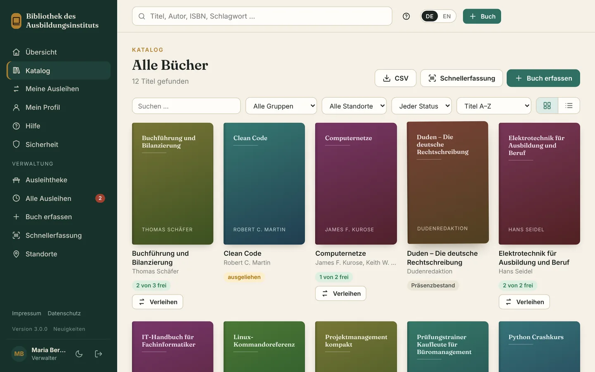
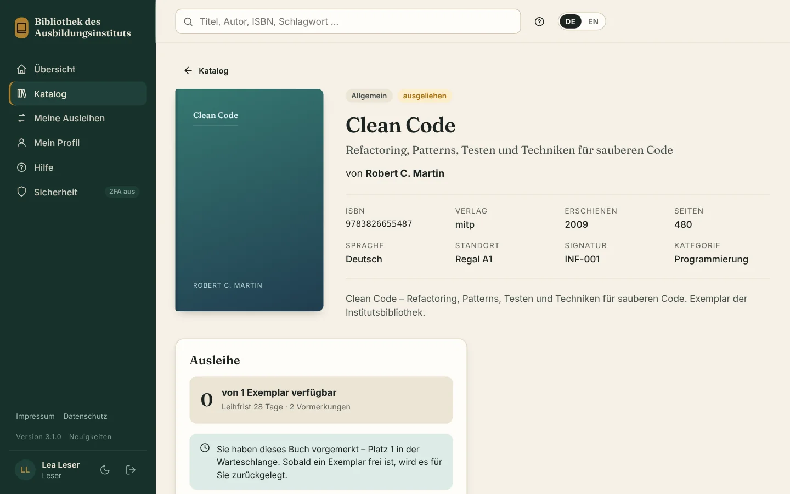
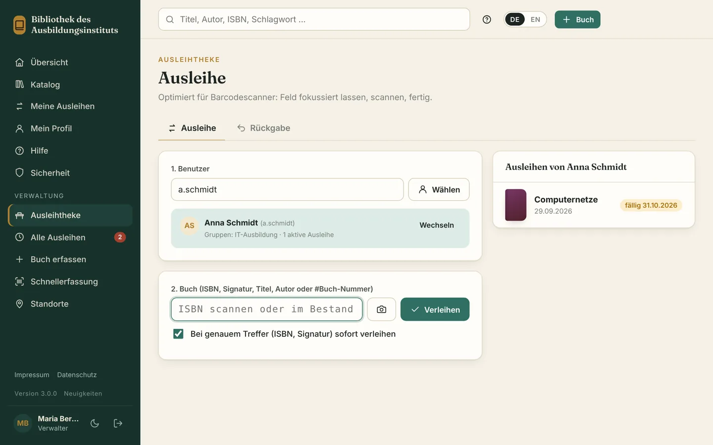

# Catalytix

**Version 3.0.1** – Änderungen siehe [CHANGELOG.md](CHANGELOG.md). · [English version](README.en.md) · Entwickelt von [helfi.space](https://helfi.space)

Webbasierte Bibliotheksverwaltung mit ISBN-Scan, Ausleihe, Gruppen und Anmeldung über Active Directory (Windows Server oder Samba). Freie Software unter der [GNU AGPL v3](#lizenz). „Catalytix“ ist der Projektname – in der Oberfläche erscheint nur der Name eurer Bibliothek.

- **Bestand pflegen** – manuell oder per ISBN: USB-/Bluetooth-Barcodescanner, Handy-/Laptop-Kamera oder Eintippen. Daten und Cover kommen automatisch von der Deutschen Nationalbibliothek, Open Library und Google Books.
- **Standorte** – feste Liste der Regale und Räume; beim Erfassen wird ausgewählt statt getippt.
- **Schnellerfassung** – ISBN für ISBN scannen; neue Titel mit einem Klick übernehmen, vorhandene um ein Exemplar erhöhen. Wird ein vorhandenes Buch (gleiche ISBN, gleiche Gruppe) noch einmal erfasst, werden die Exemplare dort hinzugezählt statt einen zweiten Eintrag anzulegen.
- **Suche mit Vorschlägen** – schon beim Tippen erscheinen passende Bücher (Suchfeld oben) und Personen (Ausleihtheke).
- **Ausleihe** – Selbstausleihe per Klick, Verleihen direkt aus dem Katalog, Ausleihtheke für den Scanner, Rückgabe, Verlängerung, Überfälligkeiten, Höchstzahl an Ausleihen, optional **Vormerken** verliehener Bücher mit Warteschlange und Abholfrist.
- **Gruppen** – jede Gruppe hat ihren Bestand; Mitglieder leihen nur Bücher ihrer Gruppen (plus „allgemeine“ Bücher). Eine Gruppe kann **Präsenzbestand** sein: Ihre Bücher stehen im Katalog, werden aber nicht verliehen und nicht vorgemerkt.
- **Rollen** – Leser, Verwalter (Bibliothekspersonal), Administrator. Lokales Admin-Konto funktioniert immer.
- **Selbstregistrierung** (optional, standardmäßig aus) – mit Freigabe durch Admins, E-Mail-Bestätigung und Domain-Beschränkung.
- **Eigenes Erscheinungsbild** – Logo, Hintergrundbild der Anmeldeseite, Farben und Begrüßungstexte.
- **Zwei-Faktor-Anmeldung** mit Authenticator-App (TOTP) oder Sicherheitsschlüssel (YubiKey/FIDO2, Passkeys), Wiederherstellungscodes und einstellbarer Pflicht je Rolle.
- **E-Mail-Benachrichtigungen** per SMTP – Ausleih- und Rückgabebestätigung, Erinnerung vor Fälligkeit, Mahnungen, tägliche Übersicht für Verwalter.
- **Active Directory / LDAP** – frei definierbar, welche OUs oder AD-Gruppen sich anmelden, verwalten oder administrieren dürfen. AD-Gruppen lassen sich Bibliotheksgruppen zuordnen.
- **Automatische Datensicherung** – täglich, die letzten 10 Sicherungen werden aufbewahrt (einstellbar).
- Modernes, responsives Design mit Hell-/Dunkelmodus. Daten in **SQLite** (Standard), optional MySQL/MariaDB oder PostgreSQL.


<p align="center">
  
</p>
<p align="center">
  
  
</p>
<p align="center"><sub>Katalog · Buchseite mit Vormerkung · Ausleihtheke (Demodaten)</sub></p>

---

## Schnellstart

Catalytix steckt komplett im fertigen Image `ghcr.io/soleil0815/catalytix` (Intel/AMD und ARM, z. B. Synology oder Raspberry Pi). Auf dem Server liegen nur **`docker-compose.yml`, `.env` und der Datenordner `./data`** – kein Programmordner, nichts zu entpacken oder zu bauen.

### Installation

```bash
mkdir -p /opt/catalytix && cd /opt/catalytix
curl -fsSLO https://github.com/soleil0815/catalytix/releases/latest/download/docker-compose.yml
curl -fsSL  https://github.com/soleil0815/catalytix/releases/latest/download/env.example -o .env
chmod 600 .env                # kann später Passwörter enthalten (z. B. DATABASE_URL)
docker compose up -d          # ältere Installationen (z. B. Synology): docker-compose up -d
```

In der `.env` ist alles optional (Port, Zeitzone, Datenbank …) – ohne Eintrag gilt die Vorgabe. Dann `http://SERVER:9300` öffnen (z. B. `http://bibliothek.firma.local:9300`). Beim ersten Aufruf legst du das lokale Administratorkonto an; dafür fragt die Seite den **Einrichtungscode** ab. Er steht im Protokoll des Containers (`docker compose logs catalytix`) und lässt sich jederzeit so anzeigen: `docker compose exec catalytix docker-entrypoint.sh flask --app wsgi setup-code`. So kann niemand, der den Port zufällig erreicht, die Einrichtung übernehmen.

Der Container setzt beim Start selbst die Rechte an `./data` und läuft danach als Benutzer `PUID:PGID` (Standard `1000:1000`) – nicht als root. Zusätzliches (z. B. ein NAS-Laufwerk für Sicherungen oder eine MariaDB) kommt in eine eigene `docker-compose.override.yml`; die wird nie angefasst.

Optional für Updates von Hand mit automatischem Weg zurück: `update.sh` in denselben Ordner legen (`curl -fsSLO https://github.com/soleil0815/catalytix/releases/latest/download/update.sh && chmod +x update.sh`).

### Update

**Mit einer Container-Verwaltung** (Dockhand, Watchtower, Tugtainer …): einfach wie andere Container aktualisieren lassen. Empfehlung: die Update-Zeit **nachts** legen (z. B. 3 Uhr) – beim Start einer neuen Version ist die Bibliothek kurz nicht erreichbar.

**Von Hand:**

```bash
docker compose pull && docker compose up -d
```

**Oder mit `./update.sh`** – macht dasselbe, und zusätzlich:
- merkt sich das laufende Image als `previous`,
- wartet, bis die neue Version gesund gemeldet wird; **startet sie nicht**, spielt es die Sicherung von vor dem Update zurück und startet wieder die vorige Version (mit Nachfrage, mit `-y` automatisch) – und bleibt vorerst bei ihr, damit eine Container-Verwaltung die fehlerhafte Version nicht gleich wieder installiert,
- legt eine neuere `docker-compose.yml` aus dem Image ab (die alte bleibt als `docker-compose.yml.alt`) und hält `update.sh` und `.env.example` aktuell.

```bash
./update.sh                     # neueste Version (oder die in der .env festgelegte)
./update.sh --version=3.0.0     # genau diese Version – auch ein Sicherheitsupdate wie 3.0.0-s1
./update.sh --version=latest    # wieder jeder neuen Version folgen
./update.sh -y                  # ohne Rückfragen (z. B. per cron)
```

Läuft mit `/bin/sh` (auch dash/BusyBox) und auf einem NAS; braucht Docker Compose als `docker compose` oder `docker-compose` ab 1.27. Ohne Terminal (cron, `ssh` ohne `-t`) und ohne `-y` entscheidet es nichts von selbst.

**Was das Programm bei jedem Versionswechsel selbst tut:** Bevor eine neue Version die Datenbank anpasst, sichert sie sie (Sicherung `catalytix-…-vor-<Version>.db` in *Administration → Datensicherung*; die letzten drei bleiben unabhängig von den täglichen erhalten). Startet eine **ältere** Version auf einer Datenbank, die schon eine neuere benutzt hat, bricht sie mit einer klaren Meldung ab (welche Version bzw. welche Sicherung) – statt mit Folgefehlern weiterzulaufen. Bei MySQL/PostgreSQL sichert ihr vor Updates selbst (`mysqldump`/`pg_dump`).

Ist die `docker-compose.yml` auf dem Server für eine neue Version zu alt, steht das im Protokoll und für Administratoren auf der Übersicht – dann einmal `./update.sh` ausführen oder die Datei aus dem Release ersetzen.

### Eine Version festlegen und zurückgehen

**Festlegen:** in der `.env` `CATALYTIX_TAG=3.0.0` eintragen (oder `./update.sh --version=3.0.0`) – dann bleibt es bei dieser Version, auch mit Container-Verwaltung. `CATALYTIX_TAG=latest` (oder die Zeile weglassen) folgt wieder jeder neuen Version.

**Zurückgehen:** Eine ältere Version braucht die Datenbank von damals. `./update.sh --version=X.Y.Z` erledigt beides: Es spielt die neueste Sicherung zurück, die diese Version lesen kann, und startet sie (es fragt vorher, denn alles seitdem Eingetragene geht verloren). Von Hand:

```bash
docker compose stop catalytix
docker compose run --rm -e CATALYTIX_SKIP_DB_CHECK=1 catalytix flask --app wsgi restore-for-version 3.0.0
# CATALYTIX_TAG=3.0.0 in die .env eintragen
docker compose up -d
```

(`restore-for-version` läuft hier noch mit dem neueren Image – das kennt den Befehl. `list-backups` zeigt alle Sicherungen.)

### Ohne Internet

Im Release liegen die Images als Dateien (`catalytix-X.Y.Z-amd64.tar.gz`, für ARM `-arm64`) mit `SHA256SUMS`. Datei, `SHA256SUMS` und `update.sh` auf den Server kopieren, dann:

```bash
./update.sh --load catalytix-3.0.0-amd64.tar.gz     # prüft die Prüfsumme, lädt das Image, startet es
```

Ohne `update.sh`: `sha256sum -c SHA256SUMS --ignore-missing`, `docker load -i catalytix-3.0.0-amd64.tar.gz`, in der `.env` `CATALYTIX_TAG=3.0.0` eintragen, `docker compose up -d`.

### Umstieg für Installationen vor 3.0.0

Bis 2.20 lagen Programmdateien auf dem Server (Zip-Paket, lokal gebaut). Ab 3.0.0 steckt alles im Image. Einmalig im bisherigen Programmordner:

1. Sicherung anlegen: *Administration → Datensicherung → Jetzt sichern* (das Programm sichert beim ersten Start von 3.0.0 zusätzlich selbst).
2. Mit dem **bisherigen** Skript einmal auf das Image umstellen: `./update.sh --pull`. Es holt 3.0.0, legt die neue `docker-compose.yml`, `.env.example` und das neue `update.sh` ab und startet. (Kennt euer Skript `--pull` noch nicht – vor 2.16 –, legt stattdessen das neue `update.sh` aus dem Release in den Ordner und startet `./update.sh`; die alte `docker-compose.yml` bleibt dann als `docker-compose.yml.alt`.)
3. Alte Programmdateien wegräumen: `./update.sh --cleanup`. Es zeigt die Liste (nur bekannte Programmdateien wie `catalytix/`, `Dockerfile`, `wsgi.py`, alte Zip-Pakete, Arbeitsordner abgebrochener Updates und lokal gebaute `catalytix:X.Y.Z`-Images), fragt und löscht nur diese. **Nie** angefasst werden `data/`, Sicherungen, `.env`, `docker-compose.yml` (samt `.alt`/`.override`) und alles, was ein Container eingebunden hat – auch nicht über Verknüpfungen.

Danach liegen im Ordner nur noch `docker-compose.yml`, `.env`, `.env.example`, `update.sh` und `data/`.

### Für Entwickler: ohne Docker

```bash
python3.13 -m venv .venv && . .venv/bin/activate     # Windows: py -3.13 -m venv .venv; .venv\Scripts\activate
pip install --no-deps -r requirements.txt
export CATALYTIX_DATA_DIR=/var/lib/catalytix
gunicorn -w 2 --threads 4 -b 0.0.0.0:9300 wsgi:app   # Windows: waitress-serve --listen=0.0.0.0:9300 wsgi:app
```

Zum Ausprobieren reicht `python wsgi.py` (nur `127.0.0.1:9300`). Das Image selbst bauen: `docker build -t catalytix-dev .`

### Feste Versionen und automatische Sicherheitsupdates

**Jeder Bau ist reproduzierbar** – alle Eingaben stehen mit exakter Version im Repository:
- **Basis-Image** mit fester Version und Prüfsumme (`ARG PYTHON_IMAGE=python:3.13.x-slim-trixie@sha256:…` im `Dockerfile`). Der Name legt den **Unterbau** fest: Debian 13 „trixie“, Python 3.13.
- **Debian-Pakete:** alle Pakete im Image, auch die des Basis-Images, werden auf einen festen Stand des Debian-Archivs gebracht (`ARG DEBIAN_SNAPSHOT=…`, über snapshot.debian.org). Welche Versionen genau drin sind, steht im Image unter `/app/image-packages.txt`.
- **Python-Pakete:** `requirements.txt` enthält alle Pakete, auch indirekte, mit exakter Version und der SHA-256-Prüfsumme jeder Datei – pip installiert nichts anderes (`--require-hashes`). `pip` selbst steht in `docker/pip.lock` und wird nach der Installation aus dem Image entfernt.
- **Neu festlegen:** `python3 tools/lock.py update` (braucht Docker und Internet) – immer nur **innerhalb des Unterbaus**: gleiche Debian-Version, gleiche Python-Reihe, jedes Paket innerhalb seiner Hauptversion (vor 1.0: Unterversion; Bereiche in `requirements.in`). Ausnahme ohne Grenze: Kalenderversionen wie die Stammzertifikate (`certifi`). Neue Paketversionen werden erst übernommen, wenn sie mindestens 7 Tage alt sind (Schutz vor frisch hochgeladenen Schadversionen). `python3 tools/lock.py check` prüft die Locks.

**Automatisch auf GitHub** (Einzelheiten unter [GitHub](#github-image-bauen-und-versionen-veröffentlichen)):
- **Jeden Montag früh – Sicherheitsupdate:** neueste Versionen innerhalb des Unterbaus festlegen, ohne Zwischenspeicher neu bauen, die Tests im fertigen Image laufen lassen, mit Trivy prüfen. Nur wenn **alles** besteht, wird das Image als `latest` und als **`<Programmversion>-s<Zähler>`** veröffentlicht (z. B. `3.0.0-s1`, `3.0.0-s2` – „gleiches Programm, nur neue Pakete“; eine neue Programmversion beginnt wieder bei `s1`), mit einem Eintrag im CHANGELOG, der die geänderten Pakete auflistet. Hat sich nichts geändert, passiert nichts.
- **Täglich:** Trivy prüft das veröffentlichte `latest` auf Schwachstellen, die erst nach dem Release bekannt wurden.
- **Wöchentlich:** Prüfung, wie lange Debian 13 und Python 3.13 noch Sicherheitsupdates bekommen. Ab 12 Monaten vorher ein Hinweis am Lauf, ab 6 Monaten wird der Lauf rot. Den Unterbau hebt niemand still an – das ist eine bewusste Änderung (siehe unten).

**Wird ein Lauf rot,** wird nichts veröffentlicht, die laufende Installation bleibt unverändert, und GitHub schickt eine E-Mail. Die Ursache steht oben am Lauf (*Actions* → Lauf öffnen, Anmerkungen und Zusammenfassung):

| Lauf / Meldung | Bedeutung | Was zu tun ist |
|---|---|---|
| *Security update* – „Trivy: … blocking finding(s)“ | Ein Paket hat eine schwere Lücke mit Korrektur, die Korrektur ist aber noch nicht im Image – meist, weil sie jünger als 7 Tage ist | Abwarten (nächster Montag) oder *Actions → Security update → Run workflow* mit `cooldown_days` = `0` starten. Hilft das nicht: die Korrektur liegt außerhalb des Unterbaus (z. B. nur in einer neuen Hauptversion) – das Paket bewusst anheben |
| *Daily scan* rot | Für das veröffentlichte Image wurde eine neue Lücke bekannt | Ebenso: *Security update* von Hand starten; ist sie nicht ausnutzbar, mit Begründung und Ablaufdatum in `.trivyignore` eintragen |
| „Tests failed in the new image“ | Ein Paket-Update verträgt sich nicht mit dem Programm | Fehler im Log ansehen, Programm anpassen oder das Paket in `requirements.in` begrenzen, neue Programmversion |
| „Locking failed“ / „Image build failed“ | Docker Hub, PyPI oder snapshot.debian.org waren nicht erreichbar oder lieferten Unerwartetes | Meist vorübergehend: Lauf später erneut starten |
| „Unreleased build changes on main“ | Auf `main` liegen Änderungen an `Dockerfile` oder `requirements.in`, die noch in keinem Release sind | Erst eine neue Programmversion veröffentlichen |
| *Foundation check* gelb/rot | Debian- oder Python-Reihe bekommt in ≤ 12 bzw. ≤ 6 Monaten keine Sicherheitsupdates mehr | Unterbau bewusst anheben: im `Dockerfile` und in `tools/lock.py` (`FOUNDATION`) auf die neue Debian-Version bzw. Python-Reihe umstellen, `tools/lock.py update`, alle Tests, neue Programmversion |

**Was Trivy stoppt:** Schwachstellen HIGH/CRITICAL, für die es eine Korrektur gibt, und gefundene Geheimnisse (z. B. Schlüssel) im Image – Letztere immer. Geprüft werden beide Plattformen (amd64 und arm64), und veröffentlicht wird genau das getestete und geprüfte Image.

**`.trivyignore`:** nur geprüfte, nicht ausnutzbare Befunde – je Eintrag `ID exp:JJJJ-MM-TT` (höchstens 6 Monate) mit einer Kommentarzeile darüber als Begründung. Nach dem Ablaufdatum blockiert der Befund wieder.

**Selbst gebaut** (`docker build .` aus dem Repository) entsteht dasselbe Image wie auf GitHub; der Bau braucht dafür Zugang zu Docker Hub, PyPI und snapshot.debian.org.

---

## Sprache und Hilfe

**Deutsch und Englisch.** Oben rechts (und auf der Anmeldeseite) schaltet jeder mit **DE / EN** um. Angemeldet wird die Wahl im Profil gespeichert – sie gilt dann auf allen Geräten und für die E-Mails an diese Person. Ohne eigene Wahl gilt die Sprache des Browsers, sonst die **Standardsprache** aus *Einstellungen → Allgemein* (Standard: Deutsch). Datumsangaben folgen der Sprache (20.10.2026 / 20 Oct 2026). Eingaben wie Buchtitel, Gruppen- und Standortnamen bleiben, wie sie erfasst wurden.

**Hilfe im Programm** (*Hilfe* in der Seitenleiste oder **?** oben rechts):
- Jeder sieht nur die Themen seiner Rolle – Leser 7, Verwalter zusätzlich 7, Administratoren alle 25.
- Das **?** springt direkt zum Abschnitt der aktuellen Seite (z. B. von der Ausleihtheke zur Hilfe für die Theke).
- Die Texte richten sich nach euren Einstellungen: Leihfrist, Verlängerungen, Selbstausleihe, E-Mail-Erinnerungen, Registrierung, Zwei-Faktor-Pflicht, AD-Konto oder lokales Konto …
- Suchfeld über alle Themen; das **Handbuch als PDF** (Deutsch bzw. Englisch, je nach Sprache) ist dort verlinkt.

**Neuigkeiten:** Unten in der Seitenleiste (neben der Versionsnummer) und im Benutzermenü steht *Neuigkeiten* – kurze, verständliche Hinweise zu neuen Funktionen, Verbesserungen und Sicherheitsupdates, je nach Rolle (Leser sehen keine reinen Admin-Themen). Gibt es nach einem Update etwas Neues, zeigt ein kleiner Punkt das an, und auf der Übersicht erscheint eine Zeile, die sich wegklicken lässt. Neue Konten starten ohne alte Meldungen. Die Texte stehen in `catalytix/news.json` (je Version, deutsch und englisch, Art `security`/`new`/`improved`/`fixed`, Zielgruppe `all`/`librarian`/`admin`).

**Handbücher:** `docs/Handbuch-Catalytix.pdf` (Deutsch) und `docs/Manual-Catalytix.pdf` (Englisch) liegen im Paket und im Image.

**Übersetzungen pflegen:** Der deutsche Text ist zugleich der Schlüssel (`_("…")` in Templates und Python, `T("…")` in `app.js`); die englischen Texte stehen in `catalytix/translations/en.json`. Der Test `tests/test_i18n.py` meldet jeden Text ohne Übersetzung und deutsche Reste auf englischen Seiten. Die Hilfetexte liegen je Sprache in `catalytix/templates/help/de|en/`.

## Standorte

*Verwaltung → Standorte* (Verwalter und Administratoren). Hier legt ihr die Regale, Räume oder Schränke einmal fest – auch mehrere auf einmal, einer pro Zeile. Sobald es mindestens einen gibt, wird der Standort beim **Erfassen, in der Schnellerfassung und beim Bearbeiten aus einer Liste gewählt** statt getippt. Groß-/Kleinschreibung und doppelte Leerzeichen werden dabei angeglichen.

- **Umbenennen** ändert den Standort bei allen betroffenen Büchern mit. **Löschen** geht erst, wenn dort kein Buch mehr steht.
- **Früher frei getippte Standorte** erscheinen unter *Im Bestand, aber nicht festgelegt*. Ihr könnt sie als Standort übernehmen oder durch einen festgelegten ersetzen – die Bücher werden mit umgestellt. Bei anderer Schreibweise („regal a2“) oder einem Tippfehler („Regl A1“) ist der passende Standort schon vorausgewählt.
- Gruppen-Verwalter können Standorte anlegen; Umbenennen und Ersetzen, das Bücher anderer Gruppen betrifft, bleibt Administratoren und Verwaltern ohne Gruppe vorbehalten.
- Im **Katalog** lässt sich nach Standort filtern.
- Ohne festgelegte Standorte bleibt das Feld ein freies Textfeld wie bisher.

## Vormerken (Reservieren)

Optional unter *Einstellungen → Vormerken* (standardmäßig aus):
- Sind alle Exemplare eines Buchs verliehen, kann man es auf der Buchseite **vormerken** und steht in einer Warteschlange. Unter *Meine Ausleihen* sieht man seine Vormerkungen samt Platz und kann sie löschen.
- Wird ein Exemplar frei (Rückgabe, zusätzliches Exemplar, Vormerkung gelöscht oder abgelaufen), wird es für die erste Person **zurückgelegt**: Sie bekommt eine E-Mail, auf der Übersicht steht „liegt für dich bereit“, an der Theke meldet die Rückgabe „Bitte zurücklegen – vorgemerkt für …“. Für alle anderen gilt das Exemplar als nicht verfügbar.
- Holt die Person es nicht innerhalb der **Abholfrist** (Standard 7 Tage) ab, ist die nächste dran. Mit der Ausleihe an sie ist die Vormerkung erledigt.
- Vorgemerkte Bücher können Leser nicht selbst verlängern (Verwalter schon). Verwalter sehen die Warteschlange auf der Buchseite und können Vormerkungen löschen.
- Abgeschlossene Vormerkungen werden mit der Aufbewahrungsfrist der Ausleihen gelöscht. Ausschalten löscht alle offenen Vormerkungen.

## Rollen und Gruppen

| Rolle | Darf |
|---|---|
| **Leser** | Katalog durchsuchen, erlaubte Bücher ausleihen, ggf. selbst verlängern/zurückgeben |
| **Verwalter** | Bücher erfassen/bearbeiten/löschen, an Benutzer verleihen, Rücknahme, Ausleihtheke – für die Bücher **seiner Gruppen** und allgemeine Bücher. Ein Verwalter **ohne** Gruppe verwaltet den gesamten Bestand. Verliert ein Gruppen-Verwalter seine letzte Gruppe (Gruppe gelöscht, im AD entfernt), verwaltet er nur noch allgemeine Bücher – den gesamten Bestand bekommt er erst, wenn ein Admin das im Benutzerkonto ausdrücklich ankreuzt. |
| **Administrator** | Alles, dazu Benutzer, Gruppen, Einstellungen und Active Directory |

Jedes Buch gehört entweder zu einer **Gruppe** oder ist **allgemein**. Allgemeine Bücher kann jeder ausleihen, Gruppenbücher nur Mitglieder der Gruppe. Unter *Einstellungen* legst du fest, ob Leser im Katalog nur ihre Bücher sehen oder den ganzen Bestand (Ausleihe bleibt trotzdem beschränkt).

---

## Active Directory einrichten

*Administration → Active Directory.* Für Windows AD, Samba AD und OpenLDAP gibt es Vorlagen-Buttons.

1. **Server**: `ldaps://dc1.schule.local` (mehrere DCs mit Komma trennen).
2. **Basis-DN**: `DC=schule,DC=local`
3. **Dienstkonto** (nur Leserechte nötig), z. B. `CN=svc-catalytix,OU=Dienstkonten,DC=schule,DC=local` oder `svc-catalytix@schule.local`.
   Alternativ ohne Dienstkonto: Feld leer lassen und **UPN-Suffix** (`schule.local`) eintragen – dann meldet sich jeder Benutzer direkt an.
4. **Rollen über AD-Gruppen** – pro Rolle die Namen der AD-Gruppen eintragen, eine pro Zeile:

   ```
   Administratoren:  Bibliothek-Admins
   Verwalter:        Bibliothek-Verwalter
   Leser:            Bibliothek-Leser
                     Domänen-Benutzer
   ```

   Mit **„Gruppen laden“** zeigt Catalytix die Gruppen aus dem AD an; ein Klick auf *Admin*, *Verwalter* oder *Leser* übernimmt sie. Mitglieder verschachtelter Gruppen zählen mit. Die höchste passende Rolle gewinnt, wer in keiner Gruppe ist, wird abgewiesen. Rollen von AD-Benutzern werden bei jeder Anmeldung neu bestimmt – Änderungen im AD wirken also beim nächsten Login.

   Statt des Namens geht auch der vollständige DN einer Gruppe (falls ein Name mehrfach vorkommt) oder eine OU (`OU=Schueler,DC=schule,DC=local` – dann zählen alle Benutzer darunter).
5. **Login testen** zeigt DN, alle Gruppen und die Rolle, die der Benutzer bekäme – ohne vorher speichern zu müssen.
6. **Bibliotheksgruppen automatisch zuordnen**: Bei einer Gruppe (Administration → Gruppen) den Namen einer AD-Gruppe eintragen, z. B. `Klasse7a`. Mitglieder werden beim Login automatisch hinzugefügt bzw. entfernt. Manuell zugeordnete Gruppen ohne AD-Verknüpfung bleiben unangetastet.

**Personen an der Theke finden:** Mit Dienstkonto findet die Suche an der Ausleihtheke und unter *An Benutzer verleihen* auch AD-Personen, die sich noch nie angemeldet haben – aber nur aktive Konten, die laut den Rollenregeln die Bibliothek nutzen dürfen. Angelegt wird das Konto erst beim ersten Verleihen (Name, E-Mail, Rolle und – mit Gruppenübernahme – Gruppen aus dem AD; kein Passwort). Ein lokales Konto mit gleichem Namen wird nie verändert. Ist das AD nicht erreichbar, findet die Suche weiter alle bekannten Benutzer. Bekannte Personen erscheinen sofort, die Treffer aus dem AD kommen einen Moment später dazu.

**AD-Abgleich und Personen-Cache** (*Active Directory → AD-Abgleich und Personen-Cache*, mit Dienstkonto standardmäßig an): Im Hintergrund – stündlich, einstellbar bis täglich, „Jetzt abgleichen“ startet ihn sofort – holt Catalytix alle AD-Personen, die laut Rollenregeln die Bibliothek nutzen dürfen, und speichert Name, Benutzername, E-Mail und Gruppen. Die Suche an der Theke findet sie dann in Millisekunden, ohne das AD zu fragen; nur wenn der Cache niemanden kennt (Neuzugang seit dem letzten Abgleich), fragt sie zusätzlich direkt das AD. Verliehen wird weiterhin nur nach einer frischen Prüfung im AD.
- Im AD **deaktivierte, gelöschte oder nicht mehr berechtigte** Personen fliegen beim nächsten Abgleich aus dem Cache.
- **Bestehende AD-Konten** werden mitgezogen (mit Dienstkonto immer – ohne Personen-Cache einmal täglich) – auch bei Personen, die sich nie anmelden: Name, E-Mail, Rolle, Bibliotheksgruppen. Ein im AD **umbenannter Anmeldename** wird übernommen; erkannt wird das Konto an der festen AD-Kennung (objectGUID), die Ausleihen ziehen mit. Wird ein Name im AD an eine neue Person vergeben, bekommt das alte Konto einen Ersatznamen (`name~ID`) und wird gesperrt – niemand übernimmt fremde Ausleihen.
- Konten von Personen, die im AD fehlen oder nicht mehr berechtigt sind, werden **gesperrt, nicht gelöscht** (die Ausleihen bleiben sichtbar; Benutzerliste: „nicht mehr im AD“) und automatisch wieder freigegeben, wenn die Person zurückkommt. Von Hand gesperrte Konten gibt der Abgleich nie frei.
- **Sicherheitsbremse:** Würde ein Abgleich mehr als 30 % der AD-Konten auf einmal sperren, sperrt er keines und meldet das (meist Basis-DN oder Filter falsch). Ist die AD-Suche unvollständig oder das AD nicht erreichbar, bleibt alles unverändert.
- Verschachtelte Gruppen löst der Abgleich nur neu auf, wenn sich die direkten Gruppen einer Person geändert haben, sonst einmal täglich – das schont das AD. Der Abgleich läuft immer nur einmal gleichzeitig, auch bei mehreren Server-Prozessen.

**Verschlüsselung:** Windows-DCs (LDAP-Signing) und Samba (`ldap server require strong auth = yes`, Standard) lehnen einfache Anmeldungen über unverschlüsseltes LDAP häufig ab. Nutze daher **LDAPS** (Port 636) oder **StartTLS**.

**Zertifikat automatisch holen:** Unter *TLS-Zertifikat* auf **„Zertifikat vom DC abrufen“** klicken. Catalytix liest die Zertifikate aller eingetragenen DCs aus und ergänzt die Stamm-CA automatisch – über die AIA-Adresse im Zertifikat (AD-Zertifikatsdienste) oder aus dem AD selbst (*Public Key Services*, mit Dienstkonto). Angezeigt werden Inhaber, Aussteller, Gültigkeit und SHA-256-Fingerabdruck; mit **„Vertrauen & speichern“** wird es übernommen. Gespeichert wird bevorzugt die Stamm-CA, damit die Verbindung auch nach einer Erneuerung des DC-Zertifikats weiter funktioniert. Wird keine Stamm-CA gefunden (z. B. bei Samba mit selbst erzeugtem Zertifikat), wird das Server-Zertifikat selbst vertraut – nach einer Erneuerung dann einfach erneut abrufen.

Den Fingerabdruck kannst du zur Sicherheit auf dem DC vergleichen, z. B. Windows: `certutil -store My`, Samba: `openssl x509 -in /var/lib/samba/private/tls/cert.pem -noout -fingerprint -sha256`.

Als Server am besten den **DNS-Namen** des DCs eintragen (so wie er im Zertifikat steht). Sprichst du den DC per IP-Adresse an, schalte „Hostname prüfen“ ab.

Dienstkonto in Samba anlegen:

```bash
samba-tool user create svc-catalytix --random-password   # Passwort danach setzen:
samba-tool user setpassword svc-catalytix
samba-tool user setexpiry svc-catalytix --noexpiry
```

Lokale Konten haben immer Vorrang. Das lokale Admin-Konto funktioniert daher auch, wenn das AD nicht erreichbar ist.

---

## Selbstregistrierung

Standardmäßig **aus**. Unter *Administration → Einstellungen → Selbstregistrierung*:

| Einstellung | Wirkung |
|---|---|
| **aus** | Kein Registrierungslink, `/registrieren` existiert nicht. |
| **Freigabe durch Administrator** | Konto wird angelegt, ist aber gesperrt, bis ein Admin es freigibt (*Benutzer → Warten auf Freigabe → Freigeben/Ablehnen*). |
| **sofort aktiv** | Konto ist direkt nutzbar. |

Optionen: **E-Mail-Adresse bestätigen** (Link, 48 h gültig – nur mit eingerichtetem E-Mail-Versand), **Admins benachrichtigen**, **erlaubte E-Mail-Domains** (z. B. `schule.de`), **Gruppe für neue Leser**, Ist unter *Rechtliches* eine Datenschutzerklärung hinterlegt, muss sie bei der Registrierung bestätigt werden.

Neue Konten sind immer **Leser**. Schutz für den Betrieb im Internet: unsichtbares Bot-Feld, Mindest-Ausfüllzeit, max. 5 Registrierungen pro Stunde und IP, reservierte Namen (admin, root …), Benutzernamen aus dem Active Directory sind gesperrt, Passwort mind. 10 Zeichen. Nicht bestätigte Konten werden nach 7 Tagen automatisch gelöscht.

## Erscheinungsbild (Corporate Design)

*Administration → Erscheinungsbild.* Alle Änderungen sind sofort in einer Vorschau zu sehen; „Anmeldeseite ansehen“ zeigt das Ergebnis so, wie Besucher es sehen.

- **Logo** (PNG mit transparentem Hintergrund oder SVG) – in Seitenleiste, Anmeldeseite, E-Mails und als Browser-Symbol (Favicon wird automatisch erzeugt). Optionen: Namen der Bibliothek daneben ein/aus, Logo auf hellem Feld (für dunkle Logos).
- **Hintergrundbild der Anmeldeseite** – wird automatisch verkleinert; Metadaten wie GPS-Position werden entfernt. Abdunkelung per Schieberegler, Bücherregal-Grafik ein/aus.
- **Farben** – Hauptfarbe (Knöpfe, Links), Akzentfarbe, Seitenleiste. Schriftfarben werden automatisch lesbar gewählt, auch im Dunkelmodus. E-Mails übernehmen Farben und Logo.
- **Texte** – Name der Bibliothek, kleine Überschrift und Begrüßungstext der Anmeldeseite.

„Alles zurücksetzen“ stellt den Auslieferungszustand wieder her. Die Dateien liegen in `./data/branding` und bleiben bei Updates erhalten. SVG-Logos mit Skripten oder externen Verweisen werden aus Sicherheitsgründen abgelehnt.

## Zwei-Faktor-Anmeldung

Jeder Benutzer richtet sie unter **Profil → Sicherheit** (oder im Benutzermenü → *Sicherheit*) ein:

- **Authenticator-App (TOTP):** QR-Code scannen, Code bestätigen. Geht mit Microsoft/Google Authenticator, Aegis, 2FAS, Bitwarden, Yubico Authenticator … – und überall, auch per `http://IP:9300` im LAN.
- **Sicherheitsschlüssel (WebAuthn/FIDO2):** YubiKey einstecken, berühren – fertig. Auch Fingerabdruck/Face-ID des Geräts (Passkey) funktioniert. Erfordert **HTTPS** und ist an die Adresse gebunden, unter der der Schlüssel registriert wurde (z. B. `bibliothek.schule.de`). Mehrere Schlüssel pro Konto sind möglich – am besten einen Ersatzschlüssel registrieren.
- **Wiederherstellungscodes:** Beim Einrichten werden 10 Einmal-Codes angezeigt (nur einmal!). Damit kommt man ohne Handy/Schlüssel noch herein.

Unter **Administration → Einstellungen** legst du fest, für wen 2FA bei **Zugriff von außen Pflicht** ist (niemand, Administratoren, Verwalter + Admins, alle). Betroffene werden nach der nächsten Anmeldung zur Einrichtung geführt und können erst danach weiterarbeiten.

**Internes Netz anders behandeln** (*Im internen Netz*):

| Einstellung | Wirkung im LAN |
|---|---|
| wie von außen (Standard) | gleiche Regeln wie aus dem Internet |
| keine Pflicht | niemand muss 2FA einrichten; wer sie eingerichtet hat, wird trotzdem gefragt |
| keine Zwei-Faktor-Abfrage | im LAN reicht das Passwort |

- **Was „intern“ ist**, legst du unter *Internes Netz* fest (ein Netz pro Zeile, z. B. `192.168.10.0/24`). Leer bedeutet `10.0.0.0/8`, `192.168.0.0/16`, `fc00::/7` und Loopback – **ohne** `172.16.0.0/12`, weil Docker seine Netze dort anlegt (sonst sähe z. B. jeder über das Docker-Gateway ankommende Zugriff intern aus). Nutzt euer LAN 172.16–31.x, tragt es ausdrücklich ein. Am besten ohnehin auf euer tatsächliches LAN eingrenzen. *Seit dieser Version:* Wer das Feld leer gelassen hat und Clients aus 172.16/12 hat, muss das Netz jetzt eintragen.
- Hinter dem Reverse-Proxy zählt die **echte Adresse des Besuchers**. Der Proxy muss dafür `X-Forwarded-For` mitschicken (Nginx Proxy Manager, Caddy und Traefik tun das von sich aus). Fehlt die Angabe, gilt der Zugriff aus Sicherheitsgründen als **extern**. Gefälschte Angaben aus dem Internet werden ignoriert.
- **Wichtig – Port 9300 nur für den Proxy:** Standardmäßig gelten alle privaten Netze als vertrauenswürdige Proxys (`CATALYTIX_TRUSTED_PROXIES=private`). Jeder Rechner im LAN, der Catalytix **direkt** auf Port 9300 erreicht, kann daher eine gefälschte `X-Forwarded-For`-Angabe mitschicken (z. B. um als „intern“ zu gelten oder die Anmeldesperre je Adresse zu umgehen). Veröffentlicht den Port daher nur für den Proxy – mit `CATALYTIX_BIND=127.0.0.1` in der `.env` (Proxy direkt auf dem Server) oder über ein gemeinsames Docker-Netz mit dem Proxy (in `docker-compose.override.yml`; `docker-compose.yml` selbst wird bei Updates ersetzt) – **oder** setzt `CATALYTIX_TRUSTED_PROXIES` auf die Adresse des Proxys (z. B. `172.18.0.5` bzw. das Docker-Netz des Proxys). Das gilt auch für Zugriffe aus dem Internet: Erreicht jemand Port 9300 z. B. über **IPv6** und Docker leitet das intern weiter, kommt die Anfrage scheinbar vom Docker-Gateway (172.x.0.1) – und dem wird mit der Standardeinstellung vertraut.
- Die Einstellungsseite zeigt, wie deine aktuelle Verbindung eingestuft wird. Zum Prüfen einmal vom Handy über mobile Daten aufrufen – dort muss „extern“ stehen.
- Eine im LAN **ohne** zweiten Faktor begonnene Sitzung gilt nur intern: Wer damit von außen zugreift (Laptop zu Hause), muss sich neu anmelden. „Angemeldet bleiben“ wirkt in diesem Fall nicht.
- Interne Geräte mit eigener öffentlicher IPv6-Adresse gelten als extern, solange ihr Präfix nicht eingetragen ist.
- **Interne Rechner über die öffentliche Domain:** Rufen sie die Internet-Adresse auf, gibt der Router (z. B. FritzBox) sie oft mit eurer eigenen öffentlichen IP aus – dann sähen sie extern aus. Trage dafür unter *Eigener Internetanschluss* eure feste IP oder euren **DynDNS-Namen** ein; der Name wird alle 5 Minuten neu aufgelöst, eine wechselnde IP wird also mitverfolgt. **Achtung:** Auch das Gäste-WLAN und alle anderen Geräte hinter dem Router kommen mit dieser Adresse an und gelten dann als intern. Die sauberere Alternative ist ein interner DNS-Eintrag (Split-DNS), der die Domain im LAN auf die interne Adresse des Servers zeigen lässt.

**Probleme bei der Anmeldung – ohne Kommandozeile:** Unter *Benutzer* → Konto öffnen → *Anmeldung und Sicherheit*:
- **Zwei-Faktor-Anmeldung zurücksetzen** – entfernt App und Sicherheitsschlüssel, die Anmeldung geht dann wieder mit dem Passwort (ist 2FA Pflicht, wird die Neueinrichtung verlangt).
- **Anmeldesperre aufheben** – nach 8 Fehlversuchen ist die Anmeldung 5 Minuten gesperrt; gesperrte Konten sind in der Benutzerliste markiert (Filter „Anmeldesperre“).

Haben sich alle Admins ausgesperrt: Mit „keine Zwei-Faktor-Abfrage“ im internen Netz kommt ein Admin vom LAN aus ohne zweiten Faktor hinein. Sonst im Notfall auf dem Server:

```bash
docker compose exec catalytix docker-entrypoint.sh flask --app wsgi reset-2fa admin
```

**Im LAN ohne zweiten Faktor angemeldet** (bei „keine Zwei-Faktor-Abfrage“ bzw. „keine Pflicht“): Wer selbst 2FA eingerichtet hat, muss den zweiten Faktor bestätigen, bevor er Faktoren oder Wiederherstellungscodes ändert oder in der Administration sicherheitsrelevante Änderungen macht – Benutzer anlegen/ändern/löschen/freigeben, 2FA zurücksetzen, Sperren aufheben, Einstellungen, Active Directory, E-Mail-Versand sowie Datensicherungen anlegen, herunterladen und löschen. Catalytix fragt dann den Code ab und führt zurück auf die Seite. Erscheinungsbild und Gruppen bleiben ohne Rückfrage änderbar.

Technisch: TOTP nach RFC 6238 (Geheimnisse verschlüsselt gespeichert, Codes nicht wiederverwendbar), WebAuthn über die Yubico-Bibliothek `fido2` inkl. Signaturzähler-Prüfung, Sperre nach mehreren Fehlversuchen. Zusätzlich gilt je Benutzername eine Grenze über alle Adressen (40 Fehlversuche in 15 Minuten von außen, 100 im internen Netz); nach 10 falschen Codes beim zweiten Faktor muss das Passwort erneut eingegeben werden. Wer sich im LAN ohne zweiten Faktor angemeldet hat, muss ihn unter *Profil → Sicherheit* erst bestätigen, bevor er Faktoren oder Wiederherstellungscodes ändern kann (Ersteinrichtung ausgenommen).

## E-Mail-Benachrichtigungen

*Administration → E-Mail.* SMTP-Server, Verschlüsselung (STARTTLS / SSL/TLS / keine), Zugangsdaten und Absender eintragen, dann **Testmail senden**.

| Benachrichtigung | Wann |
|---|---|
| Bestätigung bei Ausleihe | sofort, mit Titel und Rückgabedatum |
| Bestätigung bei Rückgabe | sofort (standardmäßig aus) |
| Erinnerung | X Tage vor Fälligkeit, einmal je Ausleihe |
| Mahnung | ab dem ersten Tag der Überfälligkeit, Wiederholung alle N Tage, höchstens M-mal |
| Übersicht an Verwalter | täglich, nur wenn es Überfälliges in ihren Gruppen gibt |
| Manuell | Briefumschlag-Symbol bei einer Ausleihe unter *Alle Ausleihen* |

- Erinnerungen und Mahnungen laufen **einmal täglich** ab der eingestellten Uhrzeit. Mehrere Bücher eines Lesers kommen in **einer** Mail. Das Versandprotokoll verhindert doppelte Mails – auch mit mehreren Server-Prozessen.
- **„Jetzt versenden“** startet den Lauf sofort. Alternativ per cron: `docker compose exec -T catalytix docker-entrypoint.sh flask --app wsgi send-reminders`
- Die **Adresse der Bibliothek** (z. B. `https://bibliothek.schule.local`) wird für Links in den Mails gebraucht.
- E-Mail-Adressen kommen bei AD-Benutzern aus dem Feld `mail`, bei lokalen Benutzern aus der Benutzerverwaltung. Lokale (auch selbst registrierte) Benutzer ändern Anzeigename und E-Mail-Adresse selbst unter *Profil → Meine Daten*; bei AD-Benutzern kommen diese Daten aus dem AD. Jeder kann Benachrichtigungen im **Profil** abschalten.
- Typische Einstellungen: Exchange/Microsoft 365 `smtp.office365.com:587 STARTTLS` · eigener Postfix intern `mail.schule.local:25 keine` · Gmail `smtp.gmail.com:587 STARTTLS` mit App-Passwort.

## Barcodescanner und Kamera

- **USB-/Bluetooth-Scanner** (Tastatur-Emulation) funktionieren ohne Einrichtung: Feld anklicken, scannen – der Scanner sendet die ISBN plus Enter.
- An der **Ausleihtheke** wird ein Code der Reihe nach als Signatur (genau, ohne Groß/Klein), ISBN und Titel gesucht. Reine Ziffern gelten **nicht mehr** als interne Buch-Nummer (bis 2.9 schon – Signaturen aus Ziffern fanden dann das falsche Buch); die Buch-Nummer gibt man jetzt mit `#` ein, z. B. `#12`.
- **Kamera-Scan** nutzt die eingebaute Barcode-Erkennung des Browsers (Chrome, Edge, Android), in Firefox und Safari die mitgelieferte eigene EAN-13-Erkennung – es wird nichts von fremden Servern nachgeladen. Browser erlauben die Kamera **nur über HTTPS** (oder `localhost`). Betreibe Catalytix dafür hinter einem Reverse-Proxy mit Zertifikat.

Beispiel mit Caddy (holt Zertifikate automatisch bzw. nutzt intern `tls internal`):

```
bibliothek.schule.local {
    tls internal
    reverse_proxy 127.0.0.1:9300
}
```

Mehr ist nicht nötig: Catalytix erkennt den Reverse-Proxy automatisch. Die Weiterleitungs-Header (echte Besucher-IP, HTTPS) werden nur akzeptiert, wenn die Verbindung aus einem privaten Netz kommt – also vom Proxy, nicht direkt aus dem Internet. Cookies bekommen bei HTTPS automatisch das Secure-Flag; über `http://IP:9300` im LAN funktioniert die Anmeldung weiterhin.

**Empfehlungen für den Betrieb im Internet** (Ergebnis der Sicherheitsprüfung zu 2.15):
- **Port 9300 nur für den Proxy erreichbar machen.** Docker veröffentlicht Ports an der Host-Firewall (ufw/firewalld) vorbei. Läuft Nginx Proxy Manager auf demselben Rechner, `CATALYTIX_BIND=127.0.0.1` setzen oder beide Container in ein gemeinsames Docker-Netz hängen und den Port gar nicht veröffentlichen.
- **`CATALYTIX_TRUSTED_PROXIES` auf die Adresse des Proxys setzen** (z. B. `172.18.0.5` oder das Docker-Netz des Proxys). Standard ist „jede private Adresse“ – wer den Port direkt aus dem LAN erreicht, könnte sonst eine beliebige Absenderadresse vortäuschen. Das ist besonders wichtig, wenn im internen Netz keine Zwei-Faktor-Abfrage nötig ist; die Einstellungsseite weist dann darauf hin.
- Nginx Proxy Manager lädt beim Start die Adressbereiche von Cloudflare und CloudFront, um bei Anfragen von dort die echte Besucheradresse zu übernehmen. Nutzt ihr kein solches CDN, im NPM-Container `IP_RANGES_FETCH_ENABLED=false` setzen – dann kann niemand über diese Dienste eine fremde Absenderadresse einschleusen.
- Hinter HTTPS `CATALYTIX_SECURE_COOKIES=1` setzen und HSTS im Proxy einschalten („HSTS Enabled“ in NPM).
- **Basis-Adresse für E-Mail-Links** (*Administration → E-Mail*) eintragen – Links in Mails entstehen nur daraus, nie aus der Anfrage. Ohne sie ist die Selbstregistrierung mit E-Mail-Bestätigung gesperrt.
- `PUID`/`PGID` auf einen eigenen Dienstbenutzer setzen (Standard 1000 ist meist der erste echte Benutzer des Hosts – dem gehören dann Datenbank und Schlüssel). Datenbank, Schlüssel und Sicherungen sind nur für diesen Benutzer lesbar.
- **Image-Dateien prüfen** (Weg ohne Internet): `update.sh --load` vergleicht die Datei mit `SHA256SUMS` aus dem Release und lädt sie nur, wenn die Prüfsumme stimmt. Über die Registry geholte Images prüft Docker selbst.
- Liegt `CATALYTIX_BACKUP_DIR` auf einem NAS, die Freigabe nur für den Bibliotheks-Server beschreibbar machen.

Bei Freigabe ins Internet (z. B. mit Nginx Proxy Manager) *Force SSL* und *HSTS* aktivieren und Port 9300 am Router nicht freigeben – von außen soll nur der Proxy erreichbar sein. Die Anmeldeseite verrät bewusst nichts über die Umgebung (keine Versionsnummer, kein AD-Hinweis, gleiche Fehlermeldung für unbekannte Benutzer, falsche Passwörter und gesperrte Konten).

## Datenschutz und Betrieb im Internet

Catalytix ist darauf ausgelegt, dass die Browser der Nutzer **nur mit eurem eigenen Server** sprechen:

- **Schriften** (Inter, Fraunces) liegen im Programm – keine Verbindung zu Google Fonts.
- **Coverbilder** lädt der Server einmal von DNB, Open Library oder Google Books, speichert sie und liefert sie selbst aus. Auch die Vorschau beim Erfassen läuft über den eigenen Server. Dabei werden nur öffentliche Adressen abgerufen – interne Server sind über diese Funktion nicht erreichbar. Die Prüfung erfolgt beim Verbindungsaufbau für genau die Adresse, zu der verbunden wird (Schutz vor DNS-Rebinding); ein Abruf dauert höchstens 10 Sekunden. Ist ein ausgehender Proxy über `HTTPS_PROXY`/`HTTP_PROXY` gesetzt, löst der Proxy die Namen auf – dann sollte er selbst keine internen Ziele zulassen.
- **Barcode-Erkennung** ist eingebaut, es wird keine Bibliothek aus dem Internet nachgeladen.
- **ISBN-Abfragen** stellt der Server; übertragen wird nur die ISBN, nie Daten über Personen.
- **Cookies:** nur technisch notwendige (Anmeldung, Formularschutz) – kein Cookie-Banner nötig. Kein Tracking, keine Werbung.

**Impressum und Datenschutzerklärung** trägst du unter *Administration → Einstellungen → Rechtliches* ein (Adressen der Seiten, z. B. auf der Website des Instituts). Die Links erscheinen auf der Anmeldeseite, in der Seitenleiste und in jeder E-Mail; bei der Selbstregistrierung muss die Datenschutzerklärung bestätigt werden.

In die Datenschutzerklärung gehört, was Catalytix speichert: Name, Benutzername, E-Mail-Adresse, Gruppenzugehörigkeit, Ausleihen mit Datum, Protokoll der versendeten E-Mails, bei Zwei-Faktor-Anmeldung die registrierten Schlüssel. Mit dem **AD-Personen-Cache** (siehe Active Directory) zusätzlich Name, Benutzername, E-Mail und Gruppen aller AD-Personen, die die Bibliothek nutzen dürfen – auch ohne Ausleihe; sie werden beim Abgleich gelöscht, sobald jemand im AD deaktiviert, gelöscht oder nicht mehr berechtigt ist, und sofort beim Abschalten. Wird der Server von jemand anderem als der Einrichtung selbst betrieben, braucht ihr einen Vertrag zur Auftragsverarbeitung (Art. 28 DSGVO).

**Aufbewahrungsfristen** (*Einstellungen → Aufbewahrung*, Standard **12 Monate**): Abgeschlossene Ausleihen werden die eingestellte Zeit nach der Rückgabe automatisch gelöscht, ebenso Einträge im E-Mail-Protokoll. Pro Buch bleibt nur die Anzahl der Ausleihen erhalten, damit die Statistik stimmt. Laufende und überfällige Ausleihen sowie die Mahn-Einträge dazu werden nie gelöscht. Der Lauf erfolgt einmal täglich automatisch; „Jetzt bereinigen“ oder `flask --app wsgi apply-retention` startet ihn sofort. Wird ein Benutzer gelöscht, verschwinden seine Ausleihen sofort (die Anzahl pro Buch bleibt). Nicht bestätigte Selbstregistrierungen werden nach 7 Tagen gelöscht. Die Frist gehört ebenfalls in die Datenschutzerklärung.

## Sicherheit

- **Passwörter** lokaler Konten: mindestens 10 Zeichen. Nach mehreren Fehlversuchen wird die Anmeldung kurz gesperrt; von außen zusätzlich je Benutzername, falls jemand viele Adressen durchprobiert.
- **Abmelden auf allen Geräten:** *Profil → Sicherheit → Angemeldete Geräte*. Das passiert auch automatisch, wenn das Passwort geändert oder die Zwei-Faktor-Anmeldung von einem Admin zurückgesetzt wird – das aktuelle Gerät bleibt angemeldet.
- **AD-Konten** laufender Sitzungen werden alle 4 Stunden nachgeprüft (mit dem Dienstkonto): Wer im AD deaktiviert, gelöscht oder aus der berechtigten Gruppe genommen wurde, wird abgemeldet; Rolle und Gruppen werden angeglichen. Ist das AD nicht erreichbar, bleibt die Sitzung bestehen. Ohne Dienstkonto (direkter Bind) ist diese Prüfung nicht möglich.
- **Zugangsdaten** für das AD-Dienstkonto und den Mailserver sowie die **2FA-Geheimnisse** werden verschlüsselt in der Datenbank abgelegt (Schlüssel: `data/secret_key` bzw. `CATALYTIX_SECRET_KEY`). Wer die Datenbank ohne diese Datei kopiert, kann sie nicht lesen.
- **Der Schlüssel gehört zur Datenbank:** Wird er geändert oder geht er verloren, schlagen alle 2FA-Anmeldungen fehl und die gespeicherten SMTP-/AD-Passwörter sind nicht mehr lesbar. Datenbank deshalb nur **zusammen mit ihrer `secret_key`** zurückspielen oder umziehen. Catalytix merkt sich beim ersten Start einen Prüfwert des Schlüssels (nicht den Schlüssel selbst) und **startet nicht**, wenn der Schlüssel nicht zur Datenbank passt – dann im Protokoll nachsehen und die passende `secret_key` zurückholen. Soll der neue Schlüssel bewusst gelten: einmalig mit `CATALYTIX_ACCEPT_NEW_KEY=1` starten (danach wieder entfernen), anschließend 2FA der Benutzer zurücksetzen und SMTP-/AD-Passwort neu eingeben.
- **Browser-Schutz:** Strenge Content-Security-Policy (nur Skripte vom eigenen Server, keine eingebetteten Skripte), Schutz vor Einbettung in fremde Seiten, CSRF-Schutz für alle Formulare.
- **Hochgeladene Cover** werden neu als JPEG gespeichert – versteckte Inhalte in Bilddateien bleiben nicht erhalten. Der **CSV-Export** markiert Zellen, die mit `=`, `+`, `-` oder `@` beginnen, damit Excel sie nicht als Formel ausführt.

## Datensicherung

*Administration → Datensicherung.* Die Datenbank wird **jeden Tag automatisch gesichert** (Standard ab 2 Uhr nachts) – im laufenden Betrieb, ohne Anhalten. Jede Sicherung wird nach dem Schreiben auf Beschädigung geprüft. Aufbewahrt werden die **neuesten 10 Sicherungen** (einstellbar 1–100), ältere werden automatisch gelöscht.

- **Ablage:** `./data/backups` auf dem Server. Mit `CATALYTIX_BACKUP_DIR` lässt sich ein anderer Ordner einstellen, z. B. ein eingebundenes NAS-Laufwerk (in `docker-compose.override.yml` als zusätzliches Volume einbinden).
- **„Jetzt sichern“** legt sofort eine Sicherung an (auch vor größeren Änderungen sinnvoll). Einzelne Sicherungen lassen sich herunterladen oder löschen.
- **Schlägt eine Sicherung fehl**, erscheint ein Warnzeichen am Menüpunkt *Datensicherung*, und Administratoren bekommen eine E-Mail (wenn der E-Mail-Versand eingerichtet ist).
- Gesichert wird die **Datenbank** (Bücher, Benutzer, Ausleihen, Einstellungen). Coverbilder, Logo und `secret_key` liegen als Dateien in `./data` – für einen kompletten Umzug den ganzen Ordner mitnehmen. Eine Datenbank immer **mit ihrer `secret_key`** zurückspielen, sonst funktionieren 2FA und gespeicherte SMTP-/AD-Passwörter nicht (siehe [Sicherheit](#sicherheit)).
- Wichtig: Sicherungen auf demselben Server schützen vor Bedienfehlern und defekten Updates, **nicht** vor einem Festplattenausfall. Kopiert den Ordner regelmäßig an einen anderen Ort.
- **Vor jedem Versionswechsel** sichert das Programm beim Start selbst (`catalytix-…-vor-X.Y.Z.db`, „vor Update auf X.Y.Z“). Die letzten drei dieser Sicherungen bleiben zusätzlich zu den täglichen erhalten – sie sind der Weg zurück (siehe [Eine Version festlegen und zurückgehen](#eine-version-festlegen-und-zurückgehen)).
- Nur für SQLite. Bei MySQL/MariaDB oder PostgreSQL mit `mysqldump` bzw. `pg_dump` sichern.

**Wiederherstellen** (der aktuelle Stand wird vorher automatisch gesichert):

```bash
docker compose stop catalytix
docker compose run --rm catalytix flask --app wsgi list-backups
docker compose run --rm catalytix flask --app wsgi restore-backup catalytix-2026-10-19_020012.db
docker compose start catalytix
```

Datenschutz: Sicherungen enthalten alle Daten, auch solche, die nach der Aufbewahrungsfrist schon gelöscht wurden – bei 10 täglichen Sicherungen also bis zu 10 Tage länger. Das gehört mit in die Datenschutzerklärung.

---

## Konfiguration (Datei `.env`)

| Variable | Bedeutung |
|---|---|
| `CATALYTIX_DATA_DIR` | Datenverzeichnis (SQLite, Cover, Schlüssel). Standard: `./instance` |
| `DATABASE_URL` | z. B. `mysql+pymysql://user:pw@host/catalytix?charset=utf8mb4` oder `postgresql+psycopg://…` (MySQL-Treiber ist enthalten; für PostgreSQL `psycopg[binary]` mit fester Version in `requirements.txt` ergänzen und neu bauen) |
| `CATALYTIX_SECRET_KEY` | Sitzungs- und Verschlüsselungsschlüssel; ohne Angabe einmalig erzeugt und in `data/secret_key` gespeichert. Verschlüsselt auch 2FA-Geheimnisse und gespeicherte SMTP-/AD-Passwörter – **nicht nachträglich ändern** (siehe [Sicherheit](#sicherheit)) |
| `CATALYTIX_ACCEPT_NEW_KEY` | `1` = einen geänderten Schlüssel bewusst übernehmen (Catalytix startet sonst nicht, wenn der Schlüssel nicht zur Datenbank passt). Nur einmalig setzen |
| `CATALYTIX_BIND` | Adresse, auf der der Port veröffentlicht wird (Standard `0.0.0.0` = alle). `127.0.0.1`, wenn der Reverse-Proxy direkt auf diesem Rechner läuft (nicht als Container bzw. mit `network_mode: host`) – dann kann niemand den Proxy umgehen. Läuft der Proxy als eigener Container, besser beide in ein gemeinsames Docker-Netz hängen |
| `CATALYTIX_PORT` | Port auf dem Docker-Host (Standard `9300`) |
| `TZ` | Zeitzone (Standard `Europe/Berlin`). Fehlt die Zeitzone im Image, steht beim Start „Time zone TZ=… not found – times in UTC“ im Protokoll; prüfen mit `docker compose exec catalytix date` |
| `PUID` / `PGID` | Benutzer/Gruppe für `./data` (Standard `1000`) |
| `CATALYTIX_TRUSTED_PROXIES` | Von wem Proxy-Header akzeptiert werden: `private` (Standard), `none` oder Liste wie `172.18.0.0/16,192.168.0.11` |
| `CATALYTIX_SECURE_COOKIES` | `auto` (Standard: bei HTTPS), `1` (immer), `0` (nie) |
| `CATALYTIX_LOGLEVEL` | `INFO` (Standard), `DEBUG` für LDAP-Fehlersuche |
| `CATALYTIX_BACKUP_DIR` | Ordner für die automatischen Sicherungen (Standard: `backups` im Datenverzeichnis). Muss als Volume eingebunden sein – sonst warnt der Container beim Start |
| `CATALYTIX_COVER_VIA_PROXY` | `1` = Coverbilder über den in `HTTPS_PROXY` gesetzten Proxy laden (Standard: direkt, damit die Prüfung auf interne Adressen greift) |
| `CATALYTIX_SOURCE_URL` | Link zum Quellcode auf der Seite *Über dieses Programm* (z. B. dein GitHub-Repository) – siehe [Lizenz](#lizenz) |

Alles Weitere (Leihfrist, Verlängerungen, Selbstausleihe, ISBN-Quellen, AD) stellst du in der Oberfläche ein.

**Zur Datenbankwahl:** SQLite reicht für Schul- und Vereinsbibliotheken mit zehntausenden Titeln und vielen gleichzeitigen Lesern problemlos – und ein Backup ist einfach eine Dateikopie. MariaDB/MySQL oder PostgreSQL lohnen sich, wenn ihr ohnehin einen Datenbankserver mit Backup-Routine betreibt oder mehrere App-Server parallel laufen sollen.

---

## Wartung

```bash
# Admin-Passwort zurücksetzen
flask --app wsgi reset-password admin
# Zweiten Faktor zurücksetzen (Handy/Schlüssel verloren)
flask --app wsgi reset-2fa admin
# Aufbewahrungsfrist sofort anwenden (alte Ausleihen löschen)
flask --app wsgi apply-retention
# Erinnerungen sofort versenden
flask --app wsgi send-reminders
# Zusätzliches lokales Admin-Konto
flask --app wsgi create-admin notfall
# Datenbank jetzt sichern / Sicherungen anzeigen / zurückspielen (Server vorher anhalten)
flask --app wsgi backup
flask --app wsgi list-backups
flask --app wsgi restore-backup catalytix-2026-10-19_020012.db
```

Die Ersteinrichtung im Browser (`/setup`) ist nur einmal möglich. Gibt es später kein Administratorkonto mehr (z. B. versehentlich gelöscht), legst du eines mit `create-admin` auf dem Server an – im Web geht das aus Sicherheitsgründen nicht mehr.

Im Docker-Container über den Entrypoint, damit der Befehl wie die App als `PUID:PGID` läuft (sonst entstehen z. B. Sicherungen, die root gehören und die die App nicht anbieten kann):

```bash
docker compose exec catalytix docker-entrypoint.sh flask --app wsgi reset-password admin
```

Katalog-Export als CSV (Excel-kompatibel) gibt es im Katalog für Verwalter.

## GitHub: Image bauen und Versionen veröffentlichen

Das Repository [soleil0815/catalytix](https://github.com/soleil0815/catalytix) enthält die Workflows unter `.github/workflows/`:

| Ereignis | Was GitHub macht |
|---|---|
| Pull Request und Push auf `main` | Locks prüfen, Image **ohne Zwischenspeicher** bauen, **alle Tests im fertigen Image**, **Trivy-Scan** (`build.yml`) – veröffentlicht wird dabei **nichts** |
| *Actions → Build → Run workflow* auf `main` mit **publish** | nur für eine **neue Versionsnummer** und nur wenn alles bestanden ist: Image `ghcr.io/soleil0815/catalytix:<version>` (und `latest`, wenn es die höchste Version ist) für `linux/amd64` und `linux/arm64`, danach das Release `v<version>` mit den Image-Dateien für den Weg ohne Internet, `SHA256SUMS`, `update.sh`, `docker-compose.yml` und `env.example` |
| Montags früh (oder von Hand) | **Sicherheitsupdate** (`security-update.yml`) – siehe [Feste Versionen und automatische Sicherheitsupdates](#feste-versionen-und-automatische-sicherheitsupdates); veröffentlicht `<version>-s<Zähler>` und `latest` |
| Täglich | **Scan** des veröffentlichten `latest` (`scan.yml`) |
| Montags | **Unterbau-Prüfung** (`foundation.yml`) |

Für alle Workflows gilt: Actions auf Commit-Prüfsummen festgelegt, minimale Rechte je Job, keine gespeicherten Git-Anmeldedaten, veröffentlicht wird nur vom Zweig `main` und nie zweimal gleichzeitig, eine veröffentlichte Version wird nie überschrieben, `latest` zeigt immer auf die höchste Version. Trivy wird nicht als GitHub Action eingebunden (die Actions `trivy-action`/`setup-trivy` wurden im März 2026 kompromittiert, CVE-2026-33634), sondern als feste Version geladen und per SHA-256 geprüft (`tools/trivy.lock`, `tools/trivy_scan.py`). Gestoppt wird nur bei Schwachstellen HIGH/CRITICAL, für die es eine Korrektur gibt.

**Erster Push:**

```bash
git init -b main
git add -A
git update-index --chmod=+x update.sh docker-entrypoint.sh   # ausführbar, auch wenn unter Windows committet
git commit -m "Catalytix 3.0.0"
git remote add origin git@github.com:soleil0815/catalytix.git
git push -u origin main
```

Danach unter *Actions* den Lauf abwarten. **Einmalig das Paket öffentlich machen:** GitHub → Profil → *Packages* → `catalytix` → *Package settings* → *Change visibility* → *Public*. Sonst müssen sich die Server erst mit einem Token (Recht `read:packages`) anmelden: `docker login ghcr.io`.

**Neue Version veröffentlichen:** Versionsnummer in `catalytix/__init__.py` und im Label im `Dockerfile` erhöhen (der Workflow prüft, dass sie übereinstimmen), CHANGELOG ergänzen, Neuigkeiten für die Oberfläche in `catalytix/news.json` eintragen (der Test prüft, dass die aktuelle Version dort steht) – als **Pull Request**. Nach dem Merge: *Actions → Build → Run workflow* (Zweig `main`, **publish** anhaken). Erst dann entstehen Image, `latest` und Release; ein Tag ist nicht nötig. Die `docker-compose.yml` bleibt dabei unverändert – nur wenn sich an ihr wirklich etwas ändern muss, steigt `CATALYTIX_COMPOSE` (in der Datei, im Label `catalytix.compose` im `Dockerfile` und in `catalytix/composefile.py`).

## Tests

```bash
python -m unittest discover -s tests -v
```

**Typprüfung (mypy):** wird Schritt für Schritt eingeführt. `mypy.ini` prüft die Module, bei denen Fehler am meisten
schaden, streng – zurzeit `backup.py`, `netzone.py`, `proxy.py`, `models.py` (Rechteprüfung) und die Build-Kette in
`tools/`. Diese Prüfung muss bei jedem Pull Request bestehen. `mypy-report.ini` prüft alle Module und listet die
Funde nur in der Zusammenfassung des Prüflaufs auf, ohne ihn abzubrechen. Mit jedem Audit und jeder Version kommen
weitere Module in die strenge Liste.

```bash
pip install --require-hashes --no-deps -r tools/mypy.lock    # feste Version mit Prüfsummen (Python 3.13)
python -m mypy                                  # strenge Module – muss „Success“ melden
python -m mypy --config-file mypy-report.ini    # alle Module, nur zur Information
```

## Aufbau

```
catalytix/
  __init__.py      App-Factory, Konfiguration, CLI-Befehle
  models.py        Datenmodell (Benutzer, Gruppen, Bücher, Ausleihen, Einstellungen, Mail-Protokoll, Sicherheitsschlüssel)
  ldap_auth.py     Active-Directory-/LDAP-Anmeldung, Gruppenauflösung und Rollenregeln
  ldap_tls.py      Abruf und Prüfung der DC-Zertifikate
  twofa.py         Zwei-Faktor-Anmeldung (TOTP, WebAuthn, Wiederherstellungscodes)
  mailer.py        SMTP-Versand, Benachrichtigungen, täglicher Zeitplan
  retention.py     Aufbewahrungsfristen (alte Ausleihen und Mail-Protokoll löschen)
  backup.py        Automatische Datensicherung (SQLite), Aufbewahrung der letzten N Sicherungen
  dbversion.py     Datenbank-Version: Sicherung vor einem Versionswechsel, Abbruch bei neuerer Datenbank
  composefile.py   Versionsprüfung der docker-compose.yml
  branding.py      Logo, Hintergrundbild, Farben
  proxy.py         Automatische Reverse-Proxy- und HTTPS-Erkennung
  netzone.py       Internes Netz oder Zugriff von außen (für die Zwei-Faktor-Regeln)
  lockout.py       Anmeldesperre nach Fehlversuchen
  isbn.py          ISBN-Prüfung und Katalogabfragen (DNB, Open Library, Google Books)
  i18n.py          Mehrsprachigkeit (Deutsch/Englisch), Sprachwahl, Datumsformate
  translations/    Englische Texte (en.json)
  views/           Seiten: main (inkl. Über/Lizenz, Sprachwahl), books, loans, locations, admin, security, register, help
  templates/       Jinja-Templates (inkl. E-Mail-Vorlagen und Hilfetexte help/de, help/en)
  static/          CSS, JavaScript (ohne Build-Schritt)
docs/              Handbücher (PDF, Deutsch und Englisch)
tests/             Automatische Tests
docker-compose.yml, .env.example, update.sh   Dateien für den Server (liegen auch im Image und im Release)
```

## Lizenz

Catalytix ist freie Software unter der **GNU Affero General Public License, Version 3 oder später** (AGPL-3.0-or-later) – vollständiger Text in [LICENSE](LICENSE).

Kurz gesagt: Jeder darf Catalytix nutzen, weitergeben und verändern, auch kommerziell. Wer eine **veränderte Fassung** weitergibt **oder im Netz für andere betreibt**, muss den Quellcode dieser Fassung unter derselben Lizenz zugänglich machen. Catalytix wird ohne jede Gewährleistung bereitgestellt.

Version, Lizenz, Entwickler ([helfi.space](https://helfi.space)) und Quellcode-Link stehen nach der Anmeldung auf der Seite *Über dieses Programm* (Klick auf die Versionsnummer unten in der Seitenleiste) – die einzige Stelle, an der der Projektname „Catalytix“ erscheint. Den Link legst du mit `CATALYTIX_SOURCE_URL` in der `.env` fest.

Verwendete Bibliotheken (eigene Lizenzen, werden bei der Installation geladen): Flask, Flask-SQLAlchemy, Flask-Login, Flask-WTF, SQLAlchemy, ldap3, cryptography, fido2, segno, Pillow, requests, gunicorn/waitress.

Mitgelieferte Schriften: **Inter** (The Inter Project Authors) und **Fraunces** (The Fraunces Project Authors), beide unter der SIL Open Font License 1.1 – Lizenztexte in `catalytix/static/fonts/`.
